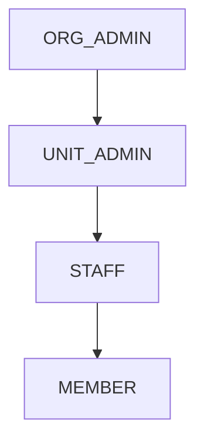

# API Reference

<!-- Copyright 2026 Chronos Ledger Contributors (Apache 2.0) -->

**Machine-readable contract**: [`docs/openapi.yaml`](openapi.yaml): OpenAPI 3.1.

**Interactive UI** (live server): `http://<server>/docs` (Swagger UI) · `http://<server>/redoc` (ReDoc)

Both, and `/openapi.json` with them, follow `DOCS_ENABLED`: off under
`APP_ENV=production` unless you set it, on everywhere else. A production
instance that publishes them hands its whole surface to anybody who finds
the host, so the file above is the contract to work from.

Base URL: `http://<server>/api/v1`

---

## Configuration

### GET /config `[public]`

What a client needs before anyone has logged in: which vocabulary to render,
and how short a password this deployment will accept. It also carries the API
version, so a client that pins one can read the version it is talking to
without leaving the `/api/v1` prefix.

```json
{
  "labels": {
    "staff": "Faculty",
    "member": "Student",
    "activity": "Course",
    "unit": "Department",
    "lead": "Instructor",
    "cycle": "Academic Year"
  },
  "password_min_length": 12,
  "version": "0.14.0"
}
```

The label keys are always the same six. Each is set on its own with
`LABEL_STAFF`, `LABEL_MEMBER`, `LABEL_ACTIVITY`, `LABEL_UNIT`, `LABEL_LEAD` or
`LABEL_CYCLE`, and anything left blank comes back as the engine's own neutral
word: `Staff`, `Member`, `Activity`, `Unit`, `Lead`, `Cycle`. There is no
domain preset behind them, so the words above are one deployment's choices and
not a mode you can select. Labels are display only: no field name in this
document changes with them.

`version` is the same string `GET /health` reports. The schema version is
not here: that is an operator's number, and this route answers before anyone
has signed in.

Labels change nothing else. The field names in this reference, the database
columns and the CSV headers stay as they are whatever the interface calls them,
so an integration reads `member_id` on a campus and `member_id` in a hospital.
[docs/vocabulary.md](vocabulary.md) is the whole subject, including which value
sets are closed and why.

`password_min_length` follows `PASSWORD_MIN_LENGTH`. Nothing here is a secret:
a caller learns the password floor from a single rejected change anyway.

---

## Errors

Every response with a status of 400 or above carries two fields:

```json
{ "detail": "Email already registered", "code": "EMAIL_TAKEN" }
```

`detail` is for a person. Its wording can change from one release to the next,
so do not match on it. It is a string for most errors, the
`{"message", "conflicts"}` object for a `409` that names the bookings in the
way, the `{"message", "reservation_id"}` object for a `409` that names the
reservation already carrying an `external_ref`, and FastAPI's list of field
errors for a `422` with `VALIDATION_FAILED`.

`code` is for a program. Branch on it. A code is never renamed, and never
reused for a different meaning once it has shipped: a new kind of failure gets
a new code. A server newer than your client can therefore send a code your
client has never seen, so fall back to the HTTP status when the code is not
one you handle. The list is the `ErrorCode` enum in
[`docs/openapi.yaml`](openapi.yaml), and a test fails if the server can send a
code that enum does not have.

An unexpected failure on the server is `500` with `INTERNAL_ERROR` and the
detail `Internal server error`. The traceback goes to the server log, never to
the caller.

One response is not an error body: `GET /health/ready` answers `503` with the
same shape it answers `200` with, so a load balancer reads one body either
way.

What a caller sees when something underneath fails (the database, Redis, the
embedded process, the clock, a lost response) and whether a retry is safe is
in [Failure modes](failure-modes.md), one case at a time, each with the test
that holds it.

| Code | Means |
| ---- | ----- |
| `BAD_REQUEST` | A `400` with no more specific code. |
| `NOT_AUTHENTICATED` | No credentials, or none this route accepts. |
| `FORBIDDEN` | A `403` with no more specific code. |
| `NOT_FOUND` | The path, or the record it names, does not exist. |
| `METHOD_NOT_ALLOWED` | The path exists but does not take this method. |
| `STATE_CONFLICT` | The record is in a state that does not allow this, for example a cycle that already has activities. |
| `PAYLOAD_TOO_LARGE` | An upload over the size limit. |
| `INVALID_VALUE` | The request had the right shape, but a value in it was refused. |
| `RATE_LIMITED` | Over a rate limit. `Retry-After` says when to try again. |
| `INTERNAL_ERROR` | Something failed on the server. |
| `SERVICE_UNAVAILABLE` | A `503` with no more specific code. |
| `VALIDATION_FAILED` | The body, query or headers did not match the declared shape. `detail` is a list. |
| `INVALID_CREDENTIALS` | Wrong email address or password, or a deactivated account signing in. |
| `TOKEN_INVALID` | The bearer token did not verify or has expired. |
| `API_KEY_INVALID` | No key matches the one sent. |
| `API_KEY_EXPIRED` | The key is past its `expires_at`. |
| `ACCOUNT_NOT_FOUND` | The token is valid but its account no longer exists. |
| `ACCOUNT_DEACTIVATED` | The token's account has been deactivated. |
| `REFRESH_TOKEN_INVALID` | The refresh token is not one this server issued. |
| `REFRESH_TOKEN_EXPIRED` | The refresh token is past its lifetime. |
| `REFRESH_TOKEN_USED` | The refresh token was spent in the last ten seconds, the way two tabs refreshing together look. Nothing else changes. |
| `REFRESH_TOKEN_REUSED` | The refresh token was spent longer ago than that. Every token from the same sign-in has stopped working. |
| `FEDERATED_TOKEN_INVALID` | The signed note from the other system did not verify. |
| `FEDERATED_EMAIL_MISSING` | The note carries no email address to create the account with. |
| `FEDERATED_ADMIN_REFUSED` | The note would sign in an administrator, which federation never does. |
| `FEDERATION_UNAVAILABLE` | Federated sign-in cannot be checked right now. |
| `CURRENT_PASSWORD_INCORRECT` | The current password given with a change is wrong. |
| `PASSWORD_UNCHANGED` | The new password is the one already set. |
| `PASSWORD_CHANGE_REQUIRED` | The account must change its initial password before anything else. |
| `INSUFFICIENT_ROLE` | The account's role is too low for this route, or for the account it is changing. |
| `SCOPE_MISSING` | The API key lacks the scope this route needs. `detail` names it. |
| `OUTSIDE_UNIT` | A unit administrator acting on someone, an activity, a room or a resource of another unit, or any unit when the account has none. |
| `IMPERSONATION_NOT_ALLOWED` | `X-Chronos-Actor` was sent by a caller that may not use it: a signed-in person, or an API key without the `impersonate` scope. |
| `IMPERSONATION_REFUSED` | `X-Chronos-Actor` named nobody the key can act for: empty, unknown, deactivated or in another organization. |
| `RESOURCE_CONFLICT` | A booking or schedule clashes with another. `detail.conflicts` lists what is in the way. |
| `ALREADY_EXISTS` | A record with that identifier or code already exists. |
| `EMAIL_TAKEN` | The email address belongs to another account. |
| `USER_DEACTIVATED` | The account named in the request is deactivated. |
| `IDEMPOTENCY_KEY_REUSED` | The `Idempotency-Key` was already used for a different request. |
| `IDEMPOTENCY_KEY_IN_PROGRESS` | A request with this `Idempotency-Key` is still running. `Retry-After` says when to try again. |
| `RESERVATION_EXTERNAL_REF_TAKEN` | Another of the caller's reservations, cancelled or not, already has that `external_ref`. `detail.reservation_id` names it. |
| `RESOURCE_CAPACITY_EXCEEDED` | A `POOLED` resource has too few units free for the whole window. `detail` carries `conflicts`, `capacity`, `taken` and `requested`. |
| `RESOURCE_BOOKINGS_WOULD_NOT_FIT` | A change of a resource's `mode` or `capacity` that bookings still to come would no longer fit. `detail.reservations` lists them. |
| `REQUIREMENT_UNSATISFIED` | A booking needs a `REQUIRED` requirement that could not be held. `detail` carries `message` and `conflicts`, as `RESOURCE_CONFLICT` does. Nothing was held. |
| `LOCATION_REQUIRED` | The session is geofenced and no location was sent. |
| `LOCATION_TOO_COARSE` | The location's accuracy is too poor to check against the geofence. |
| `OUTSIDE_GEOFENCE` | The location is outside the session's geofence. |
| `MANAGER_NOT_SET` | The account has no manager to send the request to. |
| `IMPORT_REJECTED` | A CSV import failed. `detail` is the import's error log. |
| `CHANGE_FEED_DISABLED` | The change feed is turned off on this deployment. |
| `SERVER_BUSY` | The server is out of database connections or request slots. Try again shortly. |
| `DATABASE_UNAVAILABLE` | The database refused the connection or dropped it mid-request. Nothing was committed; `Retry-After` says when to try again. |
| `WEBHOOK_URL_REFUSED` | The URL may not receive webhooks: not https, credentials in it, or an internal address. `detail` says which. |
| `WEBHOOK_SECRET_LIMIT` | The webhook already has two live signing secrets. Remove the previous one before rotating again. |

---

## Idempotency

A write whose response is lost may or may not have happened. Every `POST`,
`PATCH`, `PUT` and `DELETE` under `/api/v1` takes an optional
`Idempotency-Key` header so that a retry can find out instead of doing it
twice. Pick a fresh key for each operation (a UUID is the right shape), and
send the same key, with the same request, on every retry of it.

```http
POST /api/v1/resources/
Idempotency-Key: 0b8e6a52-3c1d-4f0e-8f43-5d2a7c9e1b60

HTTP/1.1 201 Created
Idempotency-Replayed: true
```

- The same key and the same request: the first response comes back, status
  and body, with `Idempotency-Replayed: true`. Nothing runs a second time.
- The same key and a different request: `422` with `IDEMPOTENCY_KEY_REUSED`.
  The request is the method, the path, the query string (in any order) and the
  JSON body (in any key order or spacing).
- The same key while the first request is still running: `409` with
  `IDEMPOTENCY_KEY_IN_PROGRESS` and `Retry-After: 1`. Two copies sent at once
  run once.
- A key that is empty, longer than 255 characters, or not printable ASCII:
  `422` with `INVALID_VALUE`.

A key belongs to whoever sent it: the API key when the request used one,
otherwise the signed-in user. Two callers can use the same key without
meeting. A key is remembered for `IDEMPOTENCY_RETENTION_HOURS`, 24 by default,
counted from its first use; after that it is new again, and a job at 03:45
deletes the old records.

What is kept for a replay is the response that was sent:

| First response | Kept and replayed |
| -------------- | ----------------- |
| `2xx` | Yes. |
| `4xx` | Yes, except `401`, `403` and `429`: the request ran and was refused, and would be refused again. |
| `401`, `403`, `429` | No. They are about who may ask, and a retry after signing in or waiting should run. |
| `5xx` | No, and the key is let go, so a retry runs the request again. |
| The `409` and `422` above | No. Nothing ran. |

The key is ignored, and a retry runs again, on:

- routes that need no sign-in (`/auth/login`, `/auth/refresh`,
  `/auth/logout`, `/auth/federated`): no caller to file the key under.
- routes whose response carries a secret that is stored nowhere else:
  `POST /auth/change-password`, `POST /users/{user_id}/reset-password`,
  `POST /api-keys/`, `POST /sync/feed-token/rotate`,
  `POST /guest/register-checkin`, `POST /webhooks/` and
  `POST /webhooks/{subscription_id}/rotate-secret`. Keeping the response
  would keep the secret.
- `POST /ingestion/upload-csv`, a multipart upload. An upload of the same file
  is already a no-op, and the file is not held in memory to be hashed.

`POST /resources/{id}/reservations` had a required key of its own before this
existed, and keeps its own answer to a retry: `200` with the hold as it is now
(cancelled, if it was) rather than a replay. A reused key is `422`, as on every
other write. Its key is unique per caller.

One gap is left. The key is claimed in the same transaction as the request's
own changes, and the response is recorded just after it has been sent. If the
server stops between the two, the changes are kept and the response is not,
and a retry under that key gets `IDEMPOTENCY_KEY_IN_PROGRESS` until the key
expires. That errs on the side of no duplicate.

---

## Authentication

All endpoints except `/auth/login`, `/auth/refresh`, `/auth/logout`,
`/auth/federated`, the `/config` document above and the calendar feed require
a Bearer token:

```
Authorization: Bearer <access_token>
```

Access tokens expire after `JWT_ACCESS_TOKEN_EXPIRE_MINUTES` (default: 15).
`POST /auth/refresh` exchanges the refresh token returned by `/auth/login` for a
new pair; refresh tokens are single use and last
`JWT_REFRESH_TOKEN_EXPIRE_DAYS` (default: 30). A used refresh token presented
again more than ten seconds after its use is taken to be in two hands: every
token descended from the same sign-in stops working and the client has to sign
in again. Inside those ten seconds the repeat is refused and nothing else
changes, which is what two tabs refreshing together look like.
`POST /auth/logout` ends the sign-in its refresh token belongs to.

An API key in `X-API-Key` is accepted anywhere a Bearer token is. See
[API keys](#api-keys).

A deactivated account (see `POST /users/{user_id}/deactivate` below) is
refused everywhere. Signing in answers `401 Invalid credentials`, the same as
a wrong password, and an access token issued before the deactivation gets
`401 Account deactivated`. Its API keys are deleted, so one of those gets
`401 Invalid API key`.

### Rate limits

Three routes carry a budget per caller, counted over a fixed window:

| Route                              | Counted per                                  | Default                          |
| ---------------------------------- | -------------------------------------------- | -------------------------------- |
| `POST /auth/login`                 | calling address, and separately the account  | 10 and 5 failures per 15 minutes |
| `POST /guest/register-checkin`     | the account the kiosk's API key belongs to   | 300 per hour                     |
| `GET /sync/user-feed/{token}.ics`  | the feed token                               | 60 per hour                      |

Only failed sign-ins are counted; a correct password costs nothing. Past the
budget the answer is a `429` carrying `Retry-After` in seconds:

```json
{
  "detail": "Too many sign-in attempts from this address. Try again in 840 seconds.",
  "code": "RATE_LIMITED"
}
```

Every number is a setting, `RATE_LIMIT_*` in [`.env.example`](../.env.example).
A count of `0` turns that one limiter off and `RATE_LIMIT_ENABLED=false` turns
off all three. The counters live in Redis; an instance that cannot reach Redis
stops applying the limits rather than refusing the requests.

### Role hierarchy



Higher roles inherit the permissions of all roles below them. Role is embedded in the JWT payload and validated server-side on every request.

### Organizations

Every user belongs to one organization, and everything a request reads or
writes is that organization's: its users, resources, schedules, reservations,
attendance, guests, audit trail, change feed, webhooks and calendar feeds. The
organization comes from the signed-in caller (the user behind the token or the
API key), never from the path, the query or a header, so the URLs are the same
for every organization. A role is a role within the caller's organization: an
`ORG_ADMIN` administers one organization, not the deployment.

A row that belongs to another organization is not there as far as the caller
can tell. Reading it, changing it or booking it answers `404` `NOT_FOUND`, the
same as an id that was never used, never `403`, so a caller cannot learn which
ids another organization holds.

Two keys stay unique across the whole deployment: a user's id and a user's
email address, because signing in names a user before any organization is
known. Creating a user whose id or address is taken in another organization is
refused the same way as one taken in your own. A resource `code` is unique
only within an organization, so two organizations can each have a room `101`.

A deployment starts with one organization, `default`, which holds the seeded
administrator and everything made before there was a second one. Another
organization is made by whoever runs the deployment, with
`chronos-engine organization create` ([standalone](standalone.md)); there is
no route for it.

---

### POST /auth/login

```json
// Request
{ "email_address": "user@org.internal", "password": "…" }

// Response 200
{
  "access_token": "<jwt>",
  "token_type": "bearer",
  "user_id": "FAC001",
  "role": "STAFF",
  "full_name": "Dr. Priya Sharma",
  "initial_login_state": false
}
```

`initial_login_state: true` on first login, the client should redirect to the change-password flow.

`email_address` is matched without regard to case, so somebody who types
their own address the way they write it signs in whatever case the account
was created with.

The field was called `email` before 0.13. `email` is still accepted in place
of `email_address` through 0.15 and is removed in 0.16.

### POST /auth/federated

Off unless `FEDERATED_IDENTITY_ENABLED` is true, and a `404` while it is off,
the same answer an unknown path gives: whether an instance has an integration
at all is not something probing it should reveal. The whole design, the threat
model it answers and the operator steps are in
[Federated identity](federated-identity.md); this is the route.

```json
// Request
{ "token": "<the note, exactly as its issuer minted it>" }

// Response 200
{
  "access_token": "<jwt>",
  "token_type": "bearer",
  "user_id": "FED-3f9a1c27e4b05d18",
  "role": "MEMBER",
  "full_name": "Priya R",
  "initial_login_state": false
}
```

The same pair `POST /auth/login` returns, so nothing in a client changes about
holding a session afterwards, and `POST /auth/refresh` accepts the refresh
token like any other. `initial_login_state` is false: there is no password the
account was handed, so there is nothing to move it off.

The account is found by the `(issuer, subject)` pair and never by the address
in the note. The first note for a subject creates the account, and its role
comes from the operator's own map of group claims, not from the note. A role
an administrator sets afterwards is never re-read, so an upstream change does
not reach it; `POST /users/{user_id}/deactivate` is the lever, and a
deactivated linked account is refused rather than provisioned again. An account
that has been given either admin role since it was linked is refused here too,
with `403`: no issuer may hold a route to an admin account, which is also why
`POST /federation/links` will not create one.

| Status | When                                                                      |
| ------ | ------------------------------------------------------------------------- |
| `401`  | The note was refused. One message for every reason.                       |
| `403`  | The account behind the link is an administrator and signs in by password. |
| `404`  | Federated sign-in is off on this instance.                                |
| `409`  | The address in the note belongs to an account and the pair is not linked. |
| `422`  | A malformed body, or a verified note with no usable email claim.          |
| `503`  | The replay cache is unreachable, so replay cannot be ruled out.           |

The `401` is deliberately one answer with one message, `Invalid federated
token`, whatever was wrong: an unknown issuer, a wrong audience, an unknown or
retired key, a bad signature, an expired or too long-lived note, a note already
spent, a missing subject, a link pointing at no account, a deactivated account.
The `403` is not folded into it, because none of that reasoning applies: the
note verified, the link is one an operator created, and nobody reaches this
answer without a note the issuer's key signed, so it says nothing about an
account that is not already the issuer's to sign for. What is left is a person
who was sent here by their own organization and cannot act on the refusal, so
they are told what to use instead. The role is not changed, only the route
closed; undoing the promotion makes the link work again.

The `409` is a refusal and not a link, because linking on a matching address
would let an issuer name an administrator's address and be handed the account;
an administrator links the pair by hand. The `422` for a note with no address
is not a `401` because the note was not the problem, and no note the caller
sends next would fix it. The `503` answers nothing rather than accept a note
that may be a copy; password sign-in is unaffected.

There is no rate budget here. A note is signed by a key an operator
registered, so guessing one is not the attack this route has; replay and
lifetime are, and the single-use cache and the lifetime cap answer those.

Every refusal is a `WARNING` in the server log naming the issuer, the reason
and the key id wherever the key was the part that was wrong. The note itself is
never logged, and neither is the address it carries. The log is the only place
the reason exists, so an integrator being set up is shown the log rather than
the response.

### POST /auth/change-password

```json
{ "current_password": "…", "new_password": "…" }
```

`new_password` must be at least `PASSWORD_MIN_LENGTH` characters, 12 unless the
deployment has raised it, and must not be one of the placeholder passwords
published in this repository. Either refusal is a `422` naming the rule.
Repeating the current password is a `400`: the first-login gate exists to move
the account off the password it was handed, and setting it back to itself would
satisfy the flag while changing nothing.

A successful change ends every session the account had, rotates its calendar
feed token (any subscribed calendar stops updating and needs the new URL from
`GET /sync/feed-token`), and returns a replacement refresh token for the caller:

```json
{ "message": "Password updated successfully", "refresh_token": "..." }
```

Store it over the one you hold. Skip that and the browser that changed the
password is signed out as soon as its access token expires.

### GET /auth/me

Returns the current user's `UserResponse` (see Users section), including the
`organization_id` of the organization the caller belongs to.

---

## API keys

A key authenticates a machine the way a token authenticates a person. Send it
in `X-API-Key` and it works on every endpoint a token works on. It acts as the
user it is bound to, so bind one to a service account and not to a person: a
key bound to an admin can do everything that admin can.

Unlike a token, a key can be narrowed to part of the API and can be made to
run out.

### Scopes

A scope is `<area>:read` or `<area>:write`. The area is the path segment after
`/api/v1`, and `GET`, `HEAD` and `OPTIONS` are reads while everything else is
a write. The scope a request needs is therefore read off the request, which
means no endpoint has to opt in to being covered and a new endpoint cannot
land open by nobody remembering to annotate it.

| Area | Covers |
|---|---|
| `config` | `/config` |
| `auth` | login, password change, `/auth/me` |
| `api-keys` | issuing, listing and revoking keys |
| `users` | the user directory |
| `resources` | rooms and their availability |
| `schedule` | slots, the daily ledger, cycles, staff locations |
| `attendance` | marking, absence requests, annotations |
| `guest` | the kiosk endpoints |
| `ingestion` | CSV upload and ledger generation |
| `sync` | the calendar feed |
| `admin` | the organization export (`admin:read`) |
| `audit` | the audit log |
| `changes` | the change feed |
| `webhooks` | webhook subscriptions and their deliveries |
| `federation` | the federated identity registry |

A key holding `schedule:read` passes `GET /schedule/slots` and is refused
`POST /schedule/slots` with `403` and a detail naming `schedule:write`. The
same key is refused `GET /users/` naming `users:read`: holding one area says
nothing about another.

A scope narrows what the bound account may do and never widens it. The role
checks still run as that account, so a key holding `resources:write` that is
bound to a `STAFF` account reads rooms and is refused a hold, which needs
`UNIT_ADMIN`. See [Service accounts](#service-accounts).

The single scope `*` is every area. That is what a key created without naming
any scopes gets, and what every key issued before scopes existed was
backfilled to, so nothing that worked before stopped working. `GET /api-keys/`
shows the scopes of each key, which is how you find the unrestricted ones.

`impersonate` is the one scope that is not an area, and `*` does not include
it. A key holds it only if it is named when the key is created. See
[Acting for a person](#acting-for-a-person).

### Expiry

`expires_at` is checked on the request rather than by a sweep, so a key stops
working the moment it runs out, answering `401` with `API key expired`. Omit
the field for a key that never runs out. A time already in the past is refused
at creation: a key that is dead on arrival is a mistake, not a request.

### Acting for a person

A hospital system, say, signs in as one service account and speaks for
thousands of people. To say which person a request is for, a key holding the
`impersonate` scope sends one more header:

```
X-API-Key: ck_8Kd2mQ7x...
X-Chronos-Actor: STU001
```

The request then runs as STU001: `GET /auth/me` returns STU001, the role
checks use STU001's role, and a unit administrator named this way is held to
their own unit. It is the same header the [embedded flavour](embedded.md) uses
for the same purpose. The difference is that the embedded flavour trusts its
host and makes an account for an id it has not seen, while here the id has to
name an account that already exists.

It only narrows. The key's scopes still apply, so a request has to be allowed
by both the key and the named person, and there is no ceiling on the role:
a key acting for an `ORG_ADMIN` can do what that administrator can, within its
scopes. Two examples, for a key holding `users:read` and `impersonate`:

- Acting for a `MEMBER`, `GET /users/` is `403` with `INSUFFICIENT_ROLE`.
- Acting for an `ORG_ADMIN`, `GET /users/` works but `POST /users/` is `403`
  with `SCOPE_MISSING`.

The header is never quietly ignored. Each of these is a `403`:

| Code | When |
|---|---|
| `IMPERSONATION_NOT_ALLOWED` | The request is signed in with a token, its key does not hold `impersonate` (a `*` key does not), or it issues or changes a credential (below). |
| `IMPERSONATION_REFUSED` | The id is empty, unknown, deactivated, or belongs to another organization. All of these get the same answer, so the header cannot be used to find out which ids exist. |

Rate limits and idempotency keys stay with the API key, not with the person
named, so naming other people does not mint other budgets. The same
`Idempotency-Key` with a different `X-Chronos-Actor` is a different request,
`422` with `IDEMPOTENCY_KEY_REUSED`, and never replays the first person's
answer. The audit log records both identities; see
[Audit](#audit).

A key acting for someone cannot issue or change a credential or a trust,
whatever its scopes: no writes under `/auth` (changing a password), `/api-keys`
(issuing or revoking keys) or `/federation` (trusting an issuer), and no
`POST /users/{id}/reset-password`. Each of those hands out something that
outlives the request, and acting for an administrator a key could otherwise
give itself more than the key and the person allow together. Reads in those
areas, `GET /auth/me` among them, are allowed as usual.

Because the key becomes the person for the request, scope it as tightly as
the integration allows.

### Service accounts

An admin account signing in with a password is held at the first-login gate
until it changes the password it was handed (see
[POST /auth/change-password](#post-authchange-password)). A request made with a
key is not held there: the gate exists to move a person off that password, and
a key never uses it. Issuing a key already takes an `ORG_ADMIN` who has cleared
the gate.

So a service account takes two steps, and nobody signs in as it:

1. `POST /users/` at the role the routes it calls require. Creating and editing
   rooms needs `ORG_ADMIN`; holding and releasing them needs `UNIT_ADMIN` or
   above.
2. `POST /api-keys/` bound to that account, scoped to the areas it calls (for a
   room-booking integration, `resources:read` and `resources:write`), with an
   `expires_at`.

The password set in step 1 is never used. Anyone who signs in with it still
meets the gate.

### POST /api-keys/ `[ORG_ADMIN]`

```json
{
  "label": "Hospital information system",
  "user_id": "SVC001",
  "scopes": ["schedule:read", "resources:read"],
  "expires_at": "2027-01-01T00:00:00Z"
}
```

`scopes` and `expires_at` are both optional. Omitting `scopes` gives `*`; an
empty array is refused, since a key that can reach nothing is not a key
anybody wants.

```json
{
  "id": 3,
  "key_prefix": "ck_8Kd2mQ7x",
  "label": "Hospital information system",
  "user_id": "SVC001",
  "scopes": "resources:read,schedule:read",
  "expires_at": "2027-01-01T00:00:00Z",
  "created_at": "2026-09-09T10:14:00Z",
  "api_key": "ck_8Kd2mQ7xR3nL9vB5tY1wZ0aC6eF4gH2jK8mN"
}
```

`api_key` appears here and nowhere else. Only its hash is stored, so a lost
key is revoked and reissued, never recovered. Scopes come back sorted and
deduplicated.

### GET /api-keys/ `[ORG_ADMIN]`

Every key, without its secret.

### DELETE /api-keys/{key_id} `[ORG_ADMIN]`

Revokes immediately: the next request using it gets `401`.

---

## Federation

The registry behind [POST /auth/federated](#post-authfederated): which outside
issuers this instance trusts, which public keys their notes may be signed with,
what their group claims mean here, and which accounts arrive through them.

Every route is `ORG_ADMIN`. An issuer is organization-wide and its role map can
place somebody in any unit, so a unit admin is the wrong scope for it. All of
them answer whether or not `FEDERATED_IDENTITY_ENABLED` is set: an operator has
to register an issuer and a key before the exchange is worth turning on, and it
is the exchange route that answers `404` while the feature is off.

Nothing in this table is a secret. The keys are public keys, which is why they
can be read back.

### What an issuer may and may not assert

A note names a subject and, optionally, groups. It never names a Chronos role.
The role map is the operator's, stored here, and it is what decides what a
group means. An issuer whose map has no entry for a group gets `MEMBER` with no
unit.

Neither `ORG_ADMIN` nor `UNIT_ADMIN` can be mapped. That is the whole answer to
a leaked signing key: whoever holds the key can mint a note for any subject,
and what limits the damage is that the best it buys is the level the operator
chose, which is the level that issuer's own users already had. The refusal is a
`422` from the schema and a check constraint underneath, so SQL is no way round
it either. `POST /federation/links` refuses an admin account for the same
reason, and it is the same reason rather than a second rule: a link would be a
route to an account the map could never have produced.

### POST /federation/issuers `[ORG_ADMIN]`

```json
{
  "issuer": "https://sso.example.edu",
  "display_name": "Example University SSO",
  "audience": "chronos-ledger",
  "enabled": true
}
```

`issuer` is matched against the `iss` claim exactly, and `audience` against
`aud`. `enabled` is optional and defaults to true. A second registration of the
same `issuer` is `409`.

```json
{
  "id": 1,
  "issuer": "https://sso.example.edu",
  "display_name": "Example University SSO",
  "audience": "chronos-ledger",
  "enabled": true,
  "created_at": "2026-09-25T10:00:00Z"
}
```

### GET /federation/issuers `[ORG_ADMIN]`

Every registration, oldest first.

### PATCH /federation/issuers/{issuer_id} `[ORG_ADMIN]`

`display_name`, `audience` and `enabled`, any subset. `issuer` is not on this
route: it is the value notes already in the wild carry, and editing it would
silently retarget a registration rather than register a different issuer. That
is a create and a delete.

Setting `enabled` to false refuses every note from that issuer while leaving
the keys, the map and the links in place, which is the lever to reach for when
something is wrong upstream and you want it back later.

### DELETE /federation/issuers/{issuer_id} `[ORG_ADMIN]`

Takes the keys, the map and the links with it. The accounts stay: somebody who
signed in through this issuer keeps their account and their history, and what
they lose is the shortcut. Give them a password or link them to a new
registration.

### POST /federation/issuers/{issuer_id}/keys `[ORG_ADMIN]`

```json
{
  "kid": "2026-rotation-a",
  "public_key": "-----BEGIN PUBLIC KEY-----\nMCowBQYDK2Vw...\n-----END PUBLIC KEY-----\n",
  "not_before": "2026-10-01T00:00:00Z",
  "not_after": null
}
```

A note's header must carry `kid`, and that is the key it is checked against;
`alg` is not consulted, because notes are EdDSA and nothing else. So the key
has to be an Ed25519 public key in PEM, and anything else is refused here with
`422` rather than turning into a `401` on every note that names it. A PEM that
does not parse is the same `422`.

`kid` is unique inside its issuer and not across them. Two institutions both
calling their key `default` is not a collision anybody should have to resolve.

`not_before` defaults to now and `not_after` to none, meaning no end. A window
that closes before it opens is `422`.

### GET /federation/issuers/{issuer_id}/keys `[ORG_ADMIN]`

Every key on this registration, oldest first, public keys included.

### PATCH /federation/issuers/{issuer_id}/keys/{key_id} `[ORG_ADMIN]`

```json
{ "not_after": "2026-11-01T00:00:00Z" }
```

Gives a key an end without taking it away. A moment in the future is the
overlap a planned rotation wants: add the new key, retire the old one at the
moment the issuer stops signing with it, and no note is refused in between.

A moment in the past is allowed, and it is how a leaked key is stopped now: the
next note naming it is refused. Refusing the past would leave deletion as the
only fast answer, and deletion loses the record that the key existed.

An end at or before `not_before` is `422`, with a detail saying to delete the
key instead.

### DELETE /federation/issuers/{issuer_id}/keys/{key_id} `[ORG_ADMIN]`

Removes it outright. Prefer retiring: a retired key leaves the registration
readable by somebody asking later what was trusted when.

### POST /federation/issuers/{issuer_id}/role-map `[ORG_ADMIN]`

```json
{
  "group_claim_value": "library-staff",
  "role_type": "STAFF",
  "unit_code": "LIB"
}
```

`role_type` is `STAFF` or `MEMBER`. `unit_code` is optional and is a free
string; there is no units table to check it against.

A group may appear once per issuer, so changing what one means is a delete and
an add rather than an overwrite, and a second entry for the same group is
`409`. Two groups may name two different units: a library and a lab each
mapping their own staff group is the ordinary case, and somebody in both is not
a misconfiguration.

Where several entries match one note, `STAFF` beats `MEMBER`, and among the
matching entries of the winning role the oldest supplies the unit. The rule is
deliberately independent of the order the issuer listed the groups in.

### GET /federation/issuers/{issuer_id}/role-map `[ORG_ADMIN]`

Every entry, oldest first, which is also the order that decides ties.

### DELETE /federation/issuers/{issuer_id}/role-map/{entry_id} `[ORG_ADMIN]`

Nobody who has already signed in changes. Roles are read once, when the account
is provisioned, and federation never re-reads them: re-syncing on every sign-in
would silently undo a change an administrator made here. What this changes is
what the next first-time subject in that group gets, which with no entry is
`MEMBER` and no unit.

### POST /federation/links `[ORG_ADMIN]`

```json
{ "issuer_id": 1, "subject": "a4f7c2e1-...", "user_id": "FAC001" }
```

The link is the identity. A note whose `(issuer, subject)` pair is linked is
that account, whatever address the note carries, and a note whose pair is not
linked is a stranger, whatever address it carries.

This route is the only way an account that already exists comes to use the
shortcut. The exchange never links on a matching address, because an issuer that
never verified the address it asserts could otherwise name an administrator's
and be handed their account. So somebody who already has a password here has to
be linked deliberately, by an administrator who knows the subject is theirs.

Refusals:

| Code | When |
|---|---|
| `404` | No such issuer, or no such account |
| `409` | That `(issuer, subject)` pair is already linked |
| `409` | The account is `ORG_ADMIN` or `UNIT_ADMIN` |

A deactivated account can be linked. A key bound to a deactivated account is
dead on arrival, but a link outlives the deactivation and works again on
reactivation, so refusing here would force an administrator to reactivate
somebody in order to prepare their access. Sign-in refuses the account itself
while it is deactivated, which is where that check belongs.

One account may hold several links, at one issuer or several. That is a person
with more than one upstream identity, and deciding it is a mistake is not this
route's call to make.

### GET /federation/links `[ORG_ADMIN]`

Every link, oldest first. `issuer_id` and `user_id` are optional query
parameters and narrow together.

A link made by a first sign-in has an id nobody was ever told, so this is how
one is found before it can be removed.

### DELETE /federation/links/{link_id} `[ORG_ADMIN]`

Takes the route away and leaves the account alone, with whatever role and unit
it holds. The next note carrying that pair is a stranger: refused if the address
on the account is still theirs, and provisioned as a second account if it is
not. Unlinking is not deactivating. Do both if the intent is that the person
loses access.

---

## Paging

Thirteen routes return a whole list: `GET /users/`, `GET /users/staff/available`,
`GET /resources/`, `GET /resources/reservations`, `GET /schedule/cycles`,
`GET /schedule/activities`, `GET /schedule/activities/{id}/enrollments`,
`GET /schedule/slots`,
`GET /schedule/ledger/today`, `GET /schedule/ledger`,
`GET /schedule/staff/all/locations`, `GET /audit/` and
`GET /webhooks/{subscription_id}/deliveries`.
Each takes two optional query parameters:

- `limit`: at most this many rows, 1 or more.
- `offset`: skip this many rows first, 0 or more.

Leave both off and the route returns every row it matches, as it always has.
Rows come back in id order (`code` for `GET /resources/`, `staff_id` for the
locator, date then start time for `GET /schedule/ledger`, newest first for
`GET /audit/` and for webhook deliveries), and every response, paged or not, carries `X-Total-Count`: how many rows matched before
the page was cut. A `limit` of 0 or a negative `offset` is refused with `422`,
and an offset past the end is an empty list with the count still set.

```http
GET /api/v1/users/?role=MEMBER&limit=50&offset=100

HTTP/1.1 200 OK
X-Total-Count: 1240
```

The count follows every filter the list does, including the ones the caller
does not choose: a unit admin's count is their own unit's, and a member's
`ledger/today` count is their own days. CORS exposes the header, so a page
on another allowed origin can read it.

---

## Users

### GET /users/ `[ADMIN]`

Deactivated accounts are left out unless `?include_deactivated=true`.

### POST /users/ `[ADMIN]`

Create users individually. For bulk creation, use CSV import (`POST /ingestion/upload-csv`).

A `UNIT_ADMIN` can create users only in their own unit, and only a
`ORG_ADMIN` can create an admin account. Either is refused with `403`.

```json
// POST body
{
  "id": "FAC042",
  "full_name": "Dr. Rajan Mehta",
  "email_address": "rajan@org.internal",
  "password": "InitialPass1!",
  "role_type": "STAFF",
  "unit_code": "CSE",
  "assigned_base_station": "Front Desk",
  "reporting_line_manager": "HOD001"
}
```

`reporting_line_manager` is who the user's absence requests go to for
approval. It has to name an existing user (`404` otherwise), and it cannot
name the user themselves, anyone who already reports to them, directly or
through others, or somebody who has been deactivated (`422`). The same checks run on `PATCH /users/{user_id}`, which
also refuses with `409` an email address already registered to another
account, as create does. That comparison ignores case, so
`Priya@org.internal` is the account `priya@org.internal` already is and the
second one is the same `409`. An address is stored folded to lower case,
which is the case a read of the account gives back.

### GET /users/staff/available

Every active staff member with their `current_occupancy_index`, whatever it is,
paged. `?unit=<code>` narrows it to one unit. The visitor kiosk does not use
this; it searches by name through `GET /guest/directory`.

### GET /users/{user_id}
### PATCH /users/{user_id} `[ADMIN]`

A field left out keeps its current value, and `null` clears `unit_code`,
`assigned_base_station` or `reporting_line_manager`. `full_name` and
`email_address` cannot be cleared (`422`). A `UNIT_ADMIN` can edit only the
non-admin accounts of their own unit and cannot move one to another unit.
Clearing `unit_code` counts as moving it out (`403`).

### POST /users/{user_id}/reset-password `[ADMIN]`

Issues a new random password for someone who cannot sign in, and returns it
once:

```json
{ "user_id": "STU042", "initial_password": "kQ7mZ2pV1xNc" }
```

This is the only way back into a locked-out account: `POST
/auth/change-password` needs the password the user has lost, and there is no
mail sender configured to put a reset link through. Copy the value before
closing the response. It is not stored, and calling the endpoint again issues
a different one.

A reset drops every refresh token the user holds and rotates their calendar
feed URL, so it doubles as the response to a compromised account. A
`UNIT_ADMIN` may only reset users inside their own unit, and may not reset an
admin account.

### POST /users/{user_id}/deactivate `[ADMIN]`

For somebody who has left. The account and everything recorded against it
stay, and every way in closes: signing in, refreshing, an access token
already issued, an API key bound to the account, the calendar feed and an
open WebSocket. Returns the user with `deactivated_at` set, and with the
`open_items` described below.

From then on the account is left out of `GET /users/` unless
`include_deactivated=true`, out of the staff directory and out of staff
locations. It cannot be named as a manager, a slot's lead or a day's
substitute, sent a guest, issued an API key or enrolled by a CSV import.
What already names it is left alone, and none of it stops the account being
deactivated, since refusing would keep it open for as long as the handover
takes. The response counts what is left, alongside the usual user fields, and
calling again counts afresh, so it doubles as the check that the handover is
done:

```json
{
  "deactivated_at": "2026-06-15T09:00:00Z",
  "open_items": {
    "pending_absence_requests": 1,
    "direct_reports": 2,
    "slots_led": 3,
    "ledger_rows_ahead": 14
  }
}
```

- `pending_absence_requests`: requests sent to it that nobody has decided.
  An admin decides them instead; see `GET /attendance/absence/pending`.
- `direct_reports`: active accounts naming it as their manager. Their next
  absence request is refused until they are given a new one.
- `slots_led`: slots it leads in a cycle that has not ended, drafts included.
  Each keeps producing days with it as the lead until given another.
- `ledger_rows_ahead`: rows dated today or later that it leads or covers.
  Giving a slot another lead moves its rows after today that are still
  plans; for today's row, or one it covers, name a substitute on the row.

API keys bound to the account are deleted, and reactivating does not bring
them back: an integration that signs in as the account is issued a new key.
The email address stays taken, because a deactivated account can come back.
To give the address to somebody else, change it on the deactivated account
with `PATCH /users/{user_id}` first; no route deletes an account. Calling it
on an account already deactivated changes nothing, and nobody can deactivate
their own account (`422`). A `UNIT_ADMIN` may only deactivate users inside
their own unit, and may not deactivate an admin account.

### POST /users/{user_id}/reactivate `[ADMIN]`

Lets the account back in with its password as it was. Its API keys do not
come back, since deactivating deleted them, so issue new ones with
`POST /api-keys/`. Its calendar feed URL does not work either, because
deactivating rotated it, so the new one comes from `GET /sync/feed-token`.
Follow with a reset-password if the old password should not work again. The
same `UNIT_ADMIN` limits apply.

### PUT /users/{user_id}/status

Update staff occupancy. Enum values: `OPEN_AD_HOC`, `BUSY`, `CRITICAL_DO_NOT_DISTURB`, `VERY_FREE`.
Anyone signed in can set their own; only an `ORG_ADMIN` can set somebody
else's (`403`). This is the `current_occupancy_index` the staff list, the
location routes and the kiosk directory's labels are read from. It does not
change where somebody is resolved to be.

```json
{ "status": "BUSY" }
```

---

## Resources

A resource is a thing the schedule can point at: a room, a person, a piece of
equipment. A room comes into being when a CSV import or a slot first names it,
or ahead of that through `POST /resources/`, which is how a system that manages
its own rooms registers one. An imported room knows only its name, so its
capacity and coordinates are filled in with `PATCH`.

A resource's `mode` says how a reservation takes it:

- `EXCLUSIVE`, the default, is one booking at a time, which is every resource
  made before modes existed.
- `POOLED` is a stock of `capacity` interchangeable units, such as twelve
  ventilators. A booking takes `quantity` of them, and is refused when the
  bookings already there leave too few free at some moment of its window.
- `SHARED` records who is there and refuses nobody, such as a common room.

The mode governs reservations only. The timetable is one class at a time on
every resource, and a class on a pooled resource takes the whole pool.

### GET /resources/

Optional filters: `resource_type` (`ROOM` or `PERSON`), `active`, `code`.
Readable by anyone signed in. Ordered by code, and pages with `limit` and
`offset` like the other lists.

```json
[
  {
    "id": 12,
    "code": "LH-3",
    "label": "Lecture Hall 3",
    "resource_type": "ROOM",
    "unit_code": null,
    "capacity": 90,
    "mode": "EXCLUSIVE",
    "user_id": null,
    "latitude": 12.9716,
    "longitude": 77.5946,
    "altitude_target": 920.0,
    "active": true
  }
]
```

### POST /resources/ `[ORG_ADMIN]`

Register a room before any timetable names it.

```json
{
  "code": "LH-3",
  "label": "Lecture Hall 3",
  "unit_code": "CSE",
  "capacity": 90,
  "latitude": 12.9716,
  "longitude": 77.5946,
  "altitude_target": 920.0
}
```

Only `code` is required. It is trimmed, the same as the importer trims a room
name, so a room created here and the same name in a later CSV are one row and
the import attaches its slots to this one. `label` defaults to the code.
`latitude` and `longitude` come as a pair or not at all, the same rule as on
`PATCH`. `mode` defaults to `EXCLUSIVE`; `"mode": "POOLED"` needs a `capacity`
of at least 1, and without one is `422`.

The answer is `201` with the room in the shape `GET /resources/` returns. A code
already taken in the caller's organization, whether by a room created here or
one an import made, is `409` (`a resource with that code already exists`). The
same code in another organization is a different room and does not clash. That is also what a retry gets
when its first attempt went through and the response was lost, so a caller that
meets `409` reads the room back with `GET /resources/?code=` and carries on, or
sends an `Idempotency-Key` ([Idempotency](#idempotency)) and gets the first
`201` back.

Rooms only. There is no delete either: retiring a room is `PATCH` with
`"active": false`, which keeps its calendar and every slot and day that points
at it.

### GET /resources/{id}/availability?from={date}&to={date}

When the resource is already taken, between two dates inclusive. Both
parameters are required.

```json
{
  "resource_id": 12,
  "code": "LH-3",
  "from": "2026-01-05",
  "to": "2026-01-11",
  "busy": [
    {
      "date": "2026-01-05",
      "start": "09:00:00",
      "end_date": "2026-01-05",
      "end": "10:00:00",
      "activity_id": 4,
      "activity_code": "CS101",
      "master_slot_id": 7,
      "reservation_id": null
    },
    {
      "date": "2026-01-05",
      "start": "22:00:00",
      "end_date": "2026-01-06",
      "end": "06:00:00",
      "activity_id": null,
      "activity_code": null,
      "master_slot_id": null,
      "reservation_id": 31
    }
  ]
}
```

Busy intervals, not free ones. Free time is the complement against whatever
hours the caller considers open, and only the caller knows those.

Times are naive wall clock in the organization's own timezone, the same as the
slot stores. They carry no offset and no `Z`.

What counts as taken: a weekly slot pointing at this resource whose cycle is
flagged open, on the dates from that cycle's `date_bounds_start` to its
`date_bounds_end`, both included; any reservation on it that has not been
cancelled; and any day the nightly generator has already written for it. The
flag and the dates are the two tests nightly ledger generation applies, so a
date reported free here is not one the generator is going to fill.

A generated day counts whatever its cycle now says. Closing a cycle stops the
generator producing more days and withdraws the ones it had planned from today
on, but keeps the days already past and any ahead that carry attendance or a
note, and deleting a slot leaves behind the days attendance was marked on. Those rows
still hold a room and an hour, and the database refuses a second booking on
top of them either way, so they are reported here too.

Where a generated day and the slot it came from both cover a date, you get the
day, once. The day is the row that holds the hour. It keeps the window it was
generated with when the slot is corrected later, so a moved class reads at its
old time until the days already in use have run. Dates the generator has not
reached yet still come from the slot, which is what answers for the rest of
the year.

Which kind an interval is can be read off the fields that are filled in. A
slot carries `activity_id`, `activity_code` and `master_slot_id` with a null
`reservation_id`; a reservation carries the reverse. What a booking is for is
deliberately not here: this route is readable by anyone signed in, and the
purpose is returned only to the caller that made the booking.

An interval carries `end_date` as well as `date`, and the two differ when the
window ran past midnight. `date` is the day it opened on, which for an
overnight interval is the day before the one it occupies, so an interval's
`date` can be earlier than `from`: a booking dated Monday from `22:00` to
`06:00` is on Tuesday's calendar and comes back when you ask about Tuesday.
Read each interval by its own `date` and `end_date` and not by the range that
returned it. Grouping by `date` alone files that hold under a day nobody asked
about, and discarding anything outside the range shows a ward as free while it
is staffed.

The mode changes which reservations count. On a `POOLED` resource a single
booking does not make it busy; what is reported is each stretch in which the
bookings together hold the whole pool, as an interval with every id null,
alongside the timetable as usual. On a `SHARED` resource reservations are
never reported, since nothing is ever refused for them.

`PATCH /schedule/ledger/{id}` cannot move a day's date, hour or resource, so
nothing it changes shows up here. An inactive resource still answers:
retiring a room does not clear its calendar.

`with_requirements=true` with `start` and `end` also says whether the resource
and what it requires could be held for one window, see
[Requirements](#get-resourcesidrequirements).

`from` after `to` is `422` (`from must not be after to`). A range longer than
366 days inclusive is `422` (`the range must not exceed 366 days`), which
leaves room for the next twelve months from any date, leap years included.

### PATCH /resources/{id} `[ORG_ADMIN]`

```json
{
  "label": "Lecture Hall 3",
  "capacity": 90,
  "mode": "EXCLUSIVE",
  "latitude": 12.9716,
  "longitude": 77.5946,
  "altitude_target": 920.0,
  "active": true
}
```

Every field is optional, and a field left out is left alone.

`mode` cannot be null, and a `POOLED` resource keeps a `capacity` of at least
1: leaving it without one is `422`. A change of `mode`, or of `capacity` on a
pooled resource, is checked against the bookings still standing from yesterday
on. If any would no longer fit, two that overlap on a resource made exclusive
or more than the new capacity at once on a pool, the answer is `409` with
`RESOURCE_BOOKINGS_WOULD_NOT_FIT` and the bookings in `detail.reservations`,
and nothing changes. Cancel or rebook them and try again. A change that fits
is written onto those bookings too. Leaving `SHARED` also checks them against
the timetable, which a shared booking was never refused by. `latitude` and
`longitude` are set or cleared together: sending one without the other is
`422`, since half a location fences the room to a point on the equator.
Setting them is what switches geofencing on for every session held there, so
until a room is placed, its sessions are not fenced at all.

`code`, `resource_type` and `user_id` cannot be changed here. `code` is the
importer's match key, so renaming it would make the next upload create a
second row rather than find this one; change `label` instead, which is what
gets shown. A room that becomes a person is not an edit, it is a different
resource.

### POST /resources/{id}/reservations `[ORG_ADMIN, UNIT_ADMIN]`

Hold a resource for one dated window. This is the route an outside system uses
to take a room: a hospital system books a consulting room here the same way an
admin would.

A UNIT_ADMIN holds only a resource their own unit owns, or one with no unit,
which is shared by the whole organization. A resource of another unit is `403`
`OUTSIDE_UNIT`. An ORG_ADMIN holds any resource.

An `Idempotency-Key` header is required, 8 to 120 characters and unique per
caller, and a UUID is the right shape. It is required rather than optional because a booking client
talking over a network retries, and a retry that books a second room is worse
than one that fails outright.

```json
// POST /api/v1/resources/12/reservations
// Idempotency-Key: 6f1c2e40-2c5f-4d0e-9a5b-1c7c0f9c3a11
{
  "date": "2026-01-06",
  "start": "14:00",
  "end": "15:00",
  "purpose": "Ward round",
  "external_ref": "visit-42"
}
```

`assignments` is optional too: it picks the resources for the requirements
that name a kind, see [Requirements](#get-resourcesidrequirements). The
response then also carries `children`, the holds the resource's requirements
took, and `unmet`, the advisory ones that could not be held. Both are empty
when the resource requires nothing.

`external_ref` is optional: the caller's own name for the booking, 1 to 120
characters, kept exactly as sent. With it, a caller can find, change and
cancel the booking later without having kept the `id`. See
[External references](#external-references). `quantity` is optional too, and
defaults to 1; see [Pooled and shared resources](#pooled-and-shared-resources).

`201` with the hold:

```json
{
  "id": 31,
  "resource_id": 12,
  "resource_code": "LH-3",
  "date": "2026-01-06",
  "start": "14:00:00",
  "end": "15:00:00",
  "purpose": "Ward round",
  "status": "HELD",
  "requested_by_id": "ADM001",
  "idempotency_key": "6f1c2e40-2c5f-4d0e-9a5b-1c7c0f9c3a11",
  "quantity": 1,
  "external_ref": "visit-42",
  "created_at": "2026-01-05T09:14:22Z",
  "cancelled_at": null
}
```

The same key sent again with the same body returns `200` and the original row,
cancelled or not: a retry is asking what happened, not asking for a second
room. The same key with a different body is `422` (`that Idempotency-Key was
used for a different request`). The resource is part of what the key is
checked against, so pointing one key at two different rooms is that same
`422` rather than a quiet double booking.

`409` when something already has part of the window, and the body says what it
ran into:

```json
{
  "detail": {
    "message": "the resource is already taken for part of that window",
    "conflicts": [
      {
        "date": "2026-01-06",
        "start": "14:30:00",
        "end_date": "2026-01-06",
        "end": "15:30:00",
        "activity_id": null,
        "activity_code": null,
        "master_slot_id": null,
        "reservation_id": 28
      }
    ]
  }
}
```

Windows are half open, so an interval ending at ten and one starting at ten do
not clash. Back to back bookings are the normal case and refusing them would
make a room unusable in any schedule that runs on the hour.

An `end` earlier than the `start` means the window runs past midnight and
finishes on the day after `date`: `22:00` to `06:00` is a night shift of eight
hours, not a negative sixteen. No field says which day the end falls on, only
that rule. `end` equal to `start` is `422`, because `09:00` to `09:00` is
either nothing at all or a full day and there is no way to tell which was
meant.

A weekly slot reads its two times by the same rule, so a night shift can be a
recurring slot and not only a one off hold, and an overnight booking is
checked against night shifts on the timetable as well as against day ones.

What this refuses is exactly what `GET availability` calls busy: the same
three queries, through the same expansion. The rule runs both ways. A class cannot
be put on top of a hold either, so `POST /schedule/slots`, `PATCH
/schedule/slots/{id}` and a CSV upload are each refused where a booking
already stands. A hold taken here holds against the timetable and not only
against other holds.

Two callers racing for the same window are serialized by a row lock on the
resource, two copies of one request collide on the unique key index, and
underneath both sits an exclusion constraint over the window itself,
`ex_reservations_no_overlap`. The second row is refused whatever order the two callers
arrive in. When the constraint is what catches it, the window is looked up
again and the `409` names the hold that won rather than only saying this
one lost.

#### Pooled and shared resources

All of the above is the `EXCLUSIVE` rule. On a `POOLED` resource a window the
timetable holds is still the `409` with `RESOURCE_CONFLICT`, because a class
takes the whole pool. Other bookings are not in the way one by one: they are
summed. The booking is taken when, at every moment of its window, the units
already held plus `quantity` come to no more than `capacity`. Otherwise it is
`409` with `RESOURCE_CAPACITY_EXCEEDED`:

```json
{
  "detail": {
    "message": "the resource does not have that many units left for that window",
    "conflicts": [ ... the bookings that hold it, as above ... ],
    "capacity": 12,
    "taken": 12,
    "requested": 1
  },
  "code": "RESOURCE_CAPACITY_EXCEEDED"
}
```

`taken` is the most held at any one moment of the window, so `capacity`
minus `taken` is the most this window could still have. Two bookings back to
back never add up, by the same half open rule. Callers racing for the last
units are serialized by the row lock on the resource, which on PostgreSQL is
`SELECT ... FOR UPDATE`, so the sum each one checks includes every booking
committed before it.

On a `SHARED` resource nothing is refused: not other bookings, and not the
timetable. A shared booking does not stop a class being put there either.

`quantity` above 1 on a resource that is not `POOLED` is `422`. It is part of
what a retry under the same key is compared on only when it is sent, so a
retry that leaves it out still matches a booking made before the field
existed.

#### External references

An `external_ref` is unique per caller. Sending one that another of the
caller's reservations already has, cancelled or not, is `409` with the code
`RESERVATION_EXTERNAL_REF_TAKEN` and the id of that reservation:

```json
{
  "detail": {
    "message": "a reservation of yours already has that external_ref",
    "reservation_id": 31
  },
  "code": "RESERVATION_EXTERNAL_REF_TAKEN"
}
```

Branch on `code` to tell it from the window `409`, which is
`RESOURCE_CONFLICT` with `detail.conflicts`. The two `detail` objects share
only `message`.

The reference is checked after the `Idempotency-Key` and before the window.
The same key with the same body, reference included, is still the `200`
replay of the original hold, never this `409`. The same key with a different
reference is a different request under that key, so it is the `422` for a
reused key. A new key with a reference already in use is the `409`, even when
the window is also taken, so a caller that sends the same booking twice under
two keys is told it already has it.

Two requests racing for one reference get one reservation. The unique
constraint `uq_reservations_requester_ref` refuses the second row, and the
loser gets the same `409` naming the reservation that won.

Different callers may use the same string: a reference means something only to
the system that chose it. Any number of reservations may leave it unset.

A cancelled reservation keeps its reference, so the reference still finds it
and a new booking under the same one is `409`. To book under it again, clear
or change it on the cancelled reservation first with
[`PATCH`](#patch-resourcesidreservationsreservation_id-org_admin-unit_admin).

### GET /resources/reservations `[ORG_ADMIN, UNIT_ADMIN]`

The caller's own reservations, cancelled ones included, in id order. Pages
with `limit` and `offset` like the other lists, with the total in
`X-Total-Count`. Each row has the shape the booking routes return.

```http
GET /api/v1/resources/reservations?external_ref=visit-42
```

Optional filter: `external_ref`, which matches exactly, case included, so with
it the answer is one reservation or none.

Only the caller's reservations, for every role, an `ORG_ADMIN` included. A
reference means nothing outside the system that chose it, so asking for one
must return the caller's own booking and never another caller's under the same
string. This is where an integration finds its bookings, not a view of
everybody's. It lives under `/resources` so that a key with `resources:read`
reaches it.

### PATCH /resources/{id}/reservations/{reservation_id} `[ORG_ADMIN, UNIT_ADMIN]`

Set, change or clear a reservation's `external_ref`.

```json
{ "external_ref": "visit-43" }
```

`null` clears it, and leaving the field out leaves it alone. Only the
reference can change. Any other field is `422` rather than ignored, so a
caller trying to move a booking is told it did not: moving the window is a
cancel and a new booking.

The reference is unique per requester, the same rule as on create, and taking
one already on another of the requester's reservations is the same `409` with
`RESERVATION_EXTERNAL_REF_TAKEN` and `detail.reservation_id`. When an
`ORG_ADMIN` changes somebody else's reservation, the reference is checked
against that requester's references, not the admin's.

Who may change a reservation is who may cancel it: whoever took it, or an
`ORG_ADMIN`. A `UNIT_ADMIN` that did not make it gets `403` with
`"only the caller that took a hold may change it"`. The wrong resource id is
`404`.

Returns the reservation as it now stands. A real change puts an `updated`
entry for the reservation on the [change feed](#changes); sending the
reference it already has changes nothing and adds no entry.

### DELETE /resources/{id}/reservations/{reservation_id} `[ORG_ADMIN, UNIT_ADMIN]`

Let a hold go. Returns the reservation with `status` set to `CANCELLED` and
`cancelled_at` filled in. The row stays: a deleted row cannot be told to
anybody, and a system that was informed the room was held has to be able to
learn that it no longer is.

The freed window is bookable again immediately and stops appearing in
availability. Cancelling twice is not an error and returns the same timestamp,
because the caller wanted the room free and the room is free. Cancelling
through the wrong resource id is `404`.

A hold is let go by whoever took it. A `UNIT_ADMIN` that did not make a
reservation gets `403` with `"only the caller that took a hold may cancel it"`,
which matters because more than one integration books through this route with
the same role, and one dropping another's hold is how a room goes quietly free
under a system that still believes it has it. A `ORG_ADMIN` overrides: a hold
taken by an account that has since been deleted has a null `requested_by_id`
and nobody left to cancel it.

Cancelling a booking also cancels the holds its requirements took, see
[Requirements](#get-resourcesidrequirements).

### GET /resources/{id}/requirements
### POST /resources/{id}/requirements `[ORG_ADMIN]`
### DELETE /resources/{id}/requirements/{requirement_id} `[ORG_ADMIN]`
### GET /schedule/activities/{id}/requirements `[ORG_ADMIN, UNIT_ADMIN]`
### POST /schedule/activities/{id}/requirements `[ORG_ADMIN, UNIT_ADMIN]`
### DELETE /schedule/activities/{id}/requirements/{requirement_id} `[ORG_ADMIN, UNIT_ADMIN]`

A requirement says that using one thing also needs another. The owner is a
resource (the operating theatre always needs a cleaning crew) or an activity
(this surgery list needs two nurses). The target is one named resource, or any
resource of a kind, `ROOM` or `PERSON`. An activity is never a target, because
only a resource can be held. The two owners have the same three routes, the
activity ones under `/schedule/activities/{id}`; the activity ones follow the
role and unit rules of the other activity routes, and the resource ones follow
the other resource writes: `GET` for any signed-in user, `POST` and `DELETE`
for `ORG_ADMIN`.

```json
// POST /api/v1/resources/12/requirements
{
  "target_kind": "PERSON",
  "quantity": 2,
  "before_minutes": 0,
  "after_minutes": 0,
  "enforcement": null
}
```

Set exactly one of `target_resource_id` and `target_kind`, otherwise `422`.
`quantity` is 1 by default. On a named target above 1 it is units of a pool, so
the target has to be `POOLED` (`422` if it is not); on a kind it is how many
distinct resources are needed. `before_minutes` and `after_minutes` widen the
window the target is held for, for setup and turnover; both default to 0.
`enforcement` is `REQUIRED`, `ADVISORY` or null. Null follows the
organization's `default_requirement_enforcement`, read when a booking is made,
so changing the default changes every requirement that does not say. The same
owner requiring the same target twice is `409` `ALREADY_EXISTS`. Removing a
requirement does not release holds already taken for it.

A resource may not require itself, directly or through other named resources:
saving the requirement that would close the loop is `422`. A loop that goes
through a kind cannot be seen when the requirement is saved, since which
resource a kind picks is only known at booking time; the walk leaves anything
already held in the booking out of its picks, so it ends.

**Booking.** `POST /resources/{id}/reservations` reads the resource's
requirements and holds what they ask for in the same transaction, each as its
own reservation with `parent_reservation_id` set to the booking. The `201`
body is the booking with two more fields:

```json
{
  "id": 31,
  "resource_id": 12,
  "parent_reservation_id": null,
  "children": [
    {"id": 32, "resource_id": 40, "parent_reservation_id": 31, "start": "08:45:00", "end": "10:30:00"}
  ],
  "unmet": []
}
```

- A named target is held for the window widened by the requirement's padding,
  by its own mode: an `EXCLUSIVE` one must be free, a `POOLED` one must have
  `quantity` units left, a `SHARED` one is never refused.
- A kind is filled from the request's optional `assignments`, which maps
  `ROOM` or `PERSON` to resource ids used in order (`{"assignments":
  {"PERSON": [41, 44]}}`). Where it says nothing, or runs out, the first free
  active resources of the kind by code are used, so a retry picks the same
  ones. An assigned resource that is not free is a gap and is not swapped for
  another. An id that is not an active resource of that kind in the caller's
  organization, or that no requirement asks for, is `422`.
- Requirements of the held resources are followed in turn, to a depth of 4
  (the booked resource's own requirements are depth 1). One deeper than that is
  not resolved and counts as unmet, with the enforcement it would have had. A
  resource already held in the booking is not held again, and an `EXCLUSIVE`
  one required twice is therefore a gap the second time.
- A `REQUIRED` requirement that cannot be met refuses the whole booking with
  `409` `REQUIREMENT_UNSATISFIED`. The body has the same shape as
  `RESOURCE_CONFLICT`: `detail.message` names the requirement and what is
  missing, and `detail.conflicts` the intervals in the way. Nothing is held,
  the booking included.
- An `ADVISORY` requirement that cannot be met is left out and listed in
  `unmet`, one entry per requirement: `requirement_id`, `owner_kind`,
  `owner_id`, `target_resource_id`, `target_kind`, `quantity` (how many are
  missing), `enforcement` (the resolved value), `message` and `conflicts`.
  Gaps are not stored: a replay of the same request returns the children as
  they stand with `unmet` empty.
- A padded window has to stay inside the dates it covers. Padding that would
  start before 00:00 of the booking's date, or end after the midnight that
  closes its last day, is `422` `INVALID_VALUE`; a booking that itself runs
  past midnight books fine when nothing is padded, or when the padding stays
  inside the day it finishes on.
- Two bookings racing for the last free target: on PostgreSQL a target's row
  is locked while it is checked, and the exclusion constraint settles any race
  the check misses. The loser is `409` `REQUIREMENT_UNSATISFIED` with nothing held and
  is not retried by the engine.

Cancelling the booking cancels the children that are still `HELD`, in the same
transaction. Cancelling a child by itself is allowed and does not touch the
booking. Every reservation response carries `parent_reservation_id`, null on a
booking somebody asked for.

**Availability.** `GET /resources/{id}/availability?from=D&to=D&with_requirements=true&start=09:00&end=10:00`
also answers whether the resource and everything it requires could be held for
that window, as `requirements_met` and `unmet`. It holds nothing. It needs
`from` equal to `to` and a `start` and an `end` that differ, otherwise `422`,
because a kind has no busy intervals to show: whether "any anaesthetist" is
free is a question about a window. `requirements_met` is true when the resource
itself is free and nothing it requires is missing, whatever the enforcement;
`unmet` lists every gap, advisory ones included. Without the flag
`requirements_met` is null and `unmet` is empty. It uses the same walk as the
booking, so a window it calls free is a window the booking will hold.

**The timetable.** An activity's requirements, and those of a slot's resource,
are not held by the timetable. They are checked when a slot is saved, when a
CSV is imported and when days are generated, and an unmet one is reported and
never refused:

- `GET /schedule/conflicts` has a `requirement_unmet` kind, one per slot or
  generated day and requirement, with `requirement_id` and `message` set and
  `items` holding that one row. Reservations are not checked.
- `POST /schedule/slots` and `PATCH /schedule/slots/{id}` return
  `requirements_unmet`: `requirement_id`, `date` and `message` for each
  requirement the slot's next run cannot have. The next run is the first date
  on or after today (or the cycle's start) that the rule gives, looking ahead at
  most 366 days. An empty list is the common case.
- The CSV import returns `requirements_unmet` in the same shape plus `slot_id`.
- The ledger generator writes a `logger.warning` for each day it writes whose
  requirement is unmet.

---

## Schedule

### GET /schedule/ledger/today

Returns today's `DailyLedger` entries scoped to the caller's role:
- **Staff** → sessions where they are active or substitute lead
- **Member** → sessions for their registered activities
- **ORG_ADMIN** → all sessions
- **UNIT_ADMIN** → sessions of the activities in their own unit

### GET /schedule/ledger?from=&to=

The ledger between two dates, both included, ordered by date, then start
time. Rows have the same fields as `ledger/today` and the same role filter
applies. Both dates are required; `to` before `from` is `422`. An optional
`resource_id` narrows to one resource. Pages with `limit` and `offset` like
the other lists, and a long span should be paged.

```http
GET /api/v1/schedule/ledger?from=2026-01-05&to=2026-01-11&resource_id=12&limit=100
```

### GET /schedule/conflicts?from=&to= `[ORG_ADMIN, UNIT_ADMIN]`

Where the schedule already contradicts itself between two dates, both
included. The write paths refuse a clash as it arrives, but rows written
before a check existed, a day kept by a closed cycle, or a row written
straight into the database can still get in. This route finds them and
reports them. It never refuses anything and never changes a row.

Every call is written to the [audit log](#audit), refused ones included, with
the account, the key and the status. The report names who is enrolled where,
so who read it is kept. The `from` and `to` of the call are not.

```http
GET /api/v1/schedule/conflicts?from=2026-01-05&to=2026-01-11
```

```json
{
  "from": "2026-01-05",
  "to": "2026-01-11",
  "conflicts": [
    {
      "kind": "resource_overlap",
      "resource_id": 12,
      "member_id": null,
      "lead_id": null,
      "date": "2026-01-06",
      "start": "09:30:00",
      "end_date": "2026-01-06",
      "end": "10:00:00",
      "items": [
        {"type": "slot", "id": 4, "date": "2026-01-06", "start": "09:00:00",
         "end_date": "2026-01-06", "end": "10:00:00", "activity_id": 7, "resource_id": 12},
        {"type": "reservation", "id": 31, "date": "2026-01-06", "start": "09:30:00",
         "end_date": "2026-01-06", "end": "11:00:00", "activity_id": null, "resource_id": 12}
      ]
    }
  ]
}
```

There are three kinds. A `resource_overlap` is two rows holding one resource at
the same moment. A `member_overlap` is one member enrolled in two different
activities that run at the same moment, on any resource or on none. A
`lead_overlap` is one person leading two different activities at the same
moment, with `lead_id` set. `date`, `start`, `end_date` and `end` on a
conflict are the part of the two windows they share; each item carries its own full window. `kind` and the item `type`
are strings, and a reader should skip a value it does not know, because more
kinds are expected.

A resource's mode changes what counts. On a `POOLED` resource two
reservations are never a `resource_overlap`. Instead a `resource_overbooked`
names each stretch in which the reservations together hold more than the
capacity: `items` is every reservation open in it, and `capacity` and `taken`
(the most held at once) say by how much. Those two fields are null on every
other kind. The timetable on a pooled resource still clashes as usual. On a
`SHARED` resource reservations are never reported.

A `requirement_unmet` is a different sort of thing: one row that needs
something it cannot have. It names a weekly slot or a generated day, as its
one item, whose activity or resource has a requirement the window cannot meet
(see [Requirements](#get-resourcesidrequirements)), with `requirement_id` and
`message` saying which and why. Those two fields are null on every other kind.
It is a report: the timetable never holds the extra resources, and nothing is
refused for it.

What holds a resource is what `GET /resources/{id}/availability` reports as
busy, by the same rules, so the two never disagree:
- a weekly slot (`slot`) whose cycle is open, on each date inside the cycle's
  bounds. A slot in a closed cycle produces nothing and so holds nothing.
- a generated day (`ledger_day`) that names a resource and a window, whatever
  its cycle now says, because the day was produced and is on the calendar.
  A day with no window has no time to clash over.
- a reservation (`reservation`) that is still `HELD`. A cancelled one has let
  the room go.

A generated day and the slot that produced it, on the same date, are one
class: only the day counts. Two windows of one activity are never a member
clash, since that is one activity, nor are they a lead clash. Only members
and leads whose accounts are active are checked.

The lead of a weekly slot is its `primary_lead_id`. The lead of a generated
day is its `substitute_lead_id` when that is set, and otherwise the
`active_lead_id` it was generated with, so a day that has a substitute does not
clash for the lead it was taken from, and the substitute is checked instead.
The member side counts enrollments only. Someone enrolled in one activity and
leading another at the same moment is reported as a `member_overlap` and a
`lead_overlap` by their own rules, not as a kind of their own.

Windows are half open, so one ending at 10:00 and one starting at 10:00 do
not clash. A window dated the day before `from` that runs past midnight into
the range is included, and its `date` is the day it opened on. A weekly clash
is listed once for each date it happens in the range. Each pair is named once,
and the list is ordered by kind, then `resource_id`, `member_id` or `lead_id`,
then when the shared window starts.

Both dates are required. `to` before `from` is `422` with `"from must not be
after to"`, and a range longer than 92 days is `422` with `"the range must
not exceed 92 days"`; both carry code `INVALID_VALUE`. The cap is lower than
availability's because this expands every resource and every member at once.
Admins only, because the member and lead sides name who is enrolled and who
leads where.

An ORG_ADMIN gets every clash. A UNIT_ADMIN gets the clashes in which at least
one item belongs to their own unit, each one whole, so a clash with another
unit's class still lists that class. An item belongs to a unit through its
activity, or through its resource for a reservation or a row with no activity.
A UNIT_ADMIN whose account has no unit gets none.

### PATCH /schedule/ledger/{ledger_id} `[ORG_ADMIN, UNIT_ADMIN]`

A unit admin can edit only the days of their own unit's activities. A field
left out keeps its current value, and one sent as `null` is cleared, except
`operational_state` and `delivery_format`, which cannot be (`422`). Clearing
`substitute_lead_id` takes the substitute off. The day's own `latitude_target`
and `longitude_target` are used only while both are set, so clearing either
puts the day back on its room's location, and a day without
`precision_radius_meters` is fenced at 15 m. `substitute_lead_id` has to name
an existing user (`404` otherwise) who has not been deactivated (`422`). The
response is `{"message": "Updated"}`.

```json
// Patch to switch to online delivery
{
  "delivery_format": "ONLINE_STREAM",
  "virtual_connection_string": "https://meet.google.com/xyz-abc-def"
}
```

```json
// Patch geofence for ad-hoc room change
{
  "latitude_target": 12.971598,
  "longitude_target": 77.594562,
  "altitude_target": 920.5,
  "precision_radius_meters": 15
}
```

### GET /schedule/staff/{staff_id}/location

Where somebody is right now, worked out in four tiers. See
[`docs/architecture.md`](architecture.md#4-tier-staff-location-resolution) for
the order. Open to anyone signed in, members included, since the member
dashboard's staff locator is what calls it. A user id that matches nobody, or a
deactivated account, gets `404`.

```json
{
  "resolved_location": "LH-204",
  "status": "Leading CS101 in Room LH-204",
  "staff_id": "FAC001",
  "full_name": "Dr. Priya Sharma",
  "occupancy_index": "BUSY"
}
```

`resolved_location` is a room, `OFF_SITE` for somebody on approved leave that
day, the
base station (or `Unassigned`) when nothing is scheduled, or `UNKNOWN` when a
status override answered. `status` is a sentence for display, not an enum.
Somebody covering a class is in its room with a status saying they are
substituting, and the lead they cover for is not reported in it.

### GET /schedule/staff/all/locations

Snapshot of every active staff member's location, paged. Open to anyone signed
in, like the single lookup. Polled by the Member Locator panel.

### GET /schedule/cycles
### POST /schedule/cycles `[ORG_ADMIN]`
### PATCH /schedule/cycles/{id}/close `[ORG_ADMIN]`
### PATCH /schedule/cycles/{id}/open `[ORG_ADMIN]`
### POST /schedule/cycles/{old}/clone-to/{new} `[ORG_ADMIN]`

A cycle can be created closed, filled in over as long as that takes, and put
into service once it is ready, which is what `open` is for. It is the only
thing that sets `operational_status` back to true.

A cycle's two dates are the days its slots run on, both included: the nightly
generator writes no day for a slot outside them. A `date_bounds_end` earlier
than `date_bounds_start` is refused with `422`, and equal dates are a cycle of
one day.

It is not a flag flip. A slot entered into a closed cycle is never checked
against the bookings or against the rest of the timetable, because a closed
cycle's slots occupy nothing, and every one of them starts occupying its room
the moment the flag goes true. So the checks `POST /schedule/slots` would have
run are run here instead, over every slot in the cycle at once, and the whole
open is refused where any of them lands on a room that is taken. The cycle's
own slots count against each other: two of them drafted into one room at one
hour were never refused when they were entered, and this is where they are
caught.

The body is the one a slot clash sends, with one field added:

```json
{
  "detail": {
    "message": "opening this cycle would put its slots on rooms already taken",
    "conflicts": [
      {
        "date": "2026-03-04",
        "start": "09:00:00",
        "end_date": "2026-03-04",
        "end": "10:00:00",
        "activity_id": null,
        "activity_code": null,
        "master_slot_id": null,
        "reservation_id": 41,
        "blocked_slot_id": 88
      }
    ]
  }
}
```

The eight standard keys name what was already there, read exactly as they are
read anywhere else, and `blocked_slot_id` names which of the cycle's own slots
wanted it. Every clash across every slot is listed at once rather than one per
attempt. A pair of the cycle's own slots is listed twice, once from each side,
because neither of the two is the one at fault and one of them has to move.

A refused open writes nothing: the cycle stays closed. Opening a cycle that is
already open changes nothing and returns `200`.

Two cycles may be open at once. Each slot runs only on the dates inside its
own cycle's bounds, so two cycles covering different parts of the year do not
clash, and where they do overlap the date reported is the first one both
slots run on. That is the same thing `GET /resources/{id}/availability`
reports.

`close` sets the flag back to false, so the nightly generator writes no more
days for the cycle, and removes the days it has already written from today
onward. A day that carries attendance or a note is kept rather than refused
over, because a cycle is closed at the end of a term whatever was marked on its
last morning. Days before today are not touched. Closing a cycle that is
already closed runs the same sweep.

```json
{ "message": "Cycle 3 closed", "ledger_rows_removed": 12, "ledger_rows_kept": 1 }
```

`clone-to` copies every activity in the old cycle and every weekly slot under
them into the new one, each slot with the same lead, room and window.
Enrollment and attendance are not copied: import the new cycle's CSV after
cloning. Retired activities and retired slots are not copied either, and
opening a cycle leaves its retired slots out of the room checks. The target has to be closed and have no activities, or the clone is
refused with `409`. The copied slots are not checked against the rooms here;
opening the target is what checks them.

```json
{ "cloned": 14, "cloned_slots": 31 }
```

### GET /schedule/activities?cycle_id=&include_retired=
### GET /schedule/activities/{id}
### POST /schedule/activities `[ADMIN]`
### PATCH /schedule/activities/{id} `[ADMIN]`

An activity is what a CSV row names by code, title and unit, and these build
one without a file. Anyone signed in can read them; the list is paged and
leaves retired activities out unless `include_retired=true`.

```json
{ "activity_code": "CS201", "activity_title": "Data Structures", "unit_code": "CSE", "cycle_id": 3 }
```

`POST` answers `201` with the activity, its `id` and a `retired_at` of
`null`. It starts with no slots and no members: add slots with
`POST /schedule/slots` and members with the enrollment routes below. Each slot
fills the days ahead as soon as it is added, through `materialize_horizon`,
the same function a CSV import and the nightly job call, so an activity built
here ends up with exactly the days the same activity imported from a CSV
would.

The code is unique within its cycle, retired activities included, and a
second one is refused with `409` `ALREADY_EXISTS`. A cycle that does not exist
is a `404`.

`PATCH` changes the title and nothing else. The code and the cycle are what
identify an activity, the same pair an import matches on, so changing either
is a different activity. The unit is left out because it is what a unit
admin's permission is checked against; moving an activity between units is
done by an import, which only an org admin can run.

A UNIT_ADMIN can create, change, retire and enroll only inside their own unit,
and is refused with `403` `OUTSIDE_UNIT` elsewhere.

### POST /schedule/activities/{id}/retire `[ADMIN]`
### POST /schedule/slots/{id}/retire `[ADMIN]`

Retiring takes a class off the timetable without losing what it recorded.
Nothing is deleted outright:

- The activity, and every slot it still has, gets a `retired_at`. Retiring a
  slot marks just that slot.
- The generator writes no more days for a retired slot, and it no longer
  holds its room, so a booking or another class can take the window. A day it
  keeps (below) still holds the room on that date.
- Days from today onward that nobody has marked or annotated are removed.
- Days from today onward that carry attendance or a note are kept.
- Days before today are not touched.

```json
{ "retired_at": "2026-10-13T09:12:44Z", "slots_retired": 2, "ledger_rows_removed": 14, "ledger_rows_kept": 1 }
```

That is the rule `PATCH /schedule/cycles/{id}/close` applies to a whole cycle.
It differs from `DELETE /schedule/slots/{id}`, which refuses with `409` while a
day ahead has been marked and detaches the days already past from the slot.
A retired slot keeps them.

A retired activity or slot can still be read, and `include_retired=true` puts
it back in `GET /schedule/activities` and `GET /schedule/slots`. It cannot be
edited, given slots or members, deleted or retired again, all refused with
`409` `STATE_CONFLICT`. A CSV import that names a retired activity, or a row
that lands on a retired slot, is refused with `422` and the file has to leave
it out. The retired activity's code stays taken in its cycle.

### GET /schedule/activities/{id}/enrollments `[ADMIN]`
### POST /schedule/activities/{id}/enrollments `[ADMIN]`
### DELETE /schedule/activities/{id}/enrollments/{member_id} `[ADMIN]`

The activity's roster, the same rows a CSV import writes. The list is paged.

```json
{ "member_id": "STU001" }
```

`POST` answers `201` with `{ "activity_id": 12, "member_id": "STU001" }`. The
member has to exist (`404`) and be active (`422` `USER_DEACTIVATED`), and a
second enrollment of the same member is refused with `409` `ALREADY_EXISTS`.

Days belong to slots, not to members, so neither route writes or removes a
day. An enrolled member sees the activity's days from then on; a member taken
off the roster stops seeing them, and the attendance already recorded for
them stays where it is. `DELETE` answers
`{ "activity_id": 12, "member_id": "STU001", "removed": true }`, or `404`
when the member is not enrolled.

### POST /schedule/slots `[ADMIN]`
### PATCH /schedule/slots/{id} `[ADMIN]`

Create a slot, or move an existing one. A new slot fills the days ahead
as soon as it is added, the same way an import does, rather than waiting for
the nightly job. Neither is allowed on a retired activity or slot (`409`
`STATE_CONFLICT`).

A UNIT_ADMIN may use the room of their own unit, or a room with no unit, and
is refused with `403` `OUTSIDE_UNIT` for a room of another unit. That applies
to the room a slot is created in and to the room it is moved to. Editing the
room itself stays with the ORG_ADMIN.

```json
{
  "rrule": "FREQ=WEEKLY;BYDAY=MO,WE",
  "dtstart": "2026-01-05",
  "time_window_start": "09:00:00",
  "time_window_end": "10:00:00",
  "activity_id": 12,
  "target_room_identifier": "LH-201"
}
```

The dates a slot runs on come from `rrule`, the value of one RFC 5545 RRULE
property (`RRULE:` in front is accepted and dropped), counted from `dtstart`.
Both are in the organization's calendar (`ORG_TIMEZONE`), and the slot's own
start and end are read on each date the rule gives, so a 09:00 class stays at
09:00 on both sides of a daylight saving change. The expansion is
`backend/app/core/recurrence.py::occurrences`.

`dtstart` is optional. Absent, it is the start of the activity's cycle. It is
moved forward to the rule's first date on or after it, and that is the value
stored and returned, so a stored `dtstart` is always one of the slot's dates.
A rule with no date left from there (an `UNTIL` already past) is `422`
`INVALID_VALUE`. On a `PATCH`, a new `rrule` sent without a `dtstart` starts
again from the start of the cycle.

Refused with `422`: a `FREQ` other than `DAILY`, `WEEKLY`, `MONTHLY` or
`YEARLY`; `BYHOUR`, `BYMINUTE` or `BYSECOND`, since a slot runs at most once
a date; an `UNTIL` ending in `Z`, since slot times are wall clock; anything
that is not a single rule (a `DTSTART` line, an `EXDATE`, a line break); and
a stored rule longer than 255 characters.

Both return `requirements_unmet` (the `POST` next to the slot's `id`, the
`PATCH` next to the ledger counts), the requirements of the slot's activity or
room that its next run cannot have, see
[Requirements](#get-resourcesidrequirements). The slot is saved either way.

`GET /schedule/slots` returns `rrule` and `dtstart` on each slot. It still
returns `day_of_week_index`, the ISO weekday of the slot's first date, through
0.17; it is deprecated and will be removed. The request bodies no longer take
it.

The room checks below compare dates, not weekdays. The slot's rule is
expanded into the dates it will actually run on, inside its cycle and from
tomorrow, and so is the rule of every class it is compared with, so two
rules that meet on one date in the whole cycle are refused, and two on the
same weekday that never meet (two fortnightly classes a week apart) are
not.

Both are refused with `409` where the room is already taken for part of that
window, by a booking, by another class already on the timetable, or by a day
already generated onto that room:

```json
{
  "detail": {
    "message": "the resource is held for part of that window",
    "conflicts": [
      {
        "date": "2026-03-04",
        "start": "09:00:00",
        "end_date": "2026-03-04",
        "end": "10:00:00",
        "activity_id": null,
        "activity_code": null,
        "master_slot_id": null,
        "reservation_id": 41
      }
    ]
  }
}
```

The same body `POST /resources/{id}/reservations` sends when it refuses, so a
clash reads the same way whichever end it came from. Two limits on what
counts: only holds from today forward, because a slot lays down days from now
onwards and never backwards, and nothing at all if the slot belongs to a
closed cycle, because such a slot does not occupy the room and a booking is
already accepted on top of one.

A class already on the timetable is refused the same way, with a different
message and the same shape:

```json
{
  "detail": {
    "message": "the resource is already on the timetable for part of that window",
    "conflicts": [
      {
        "date": "2026-03-04",
        "start": "09:00:00",
        "end_date": "2026-03-04",
        "end": "10:00:00",
        "activity_id": 12,
        "activity_code": "CS101",
        "master_slot_id": 88,
        "reservation_id": null
      }
    ]
  }
}
```

Which kind of thing an entry is can be read off the fields that are set: a
class names the activity and leaves `reservation_id` null, a booking does the
reverse. That is the same convention `GET /resources/{id}/availability` uses.

A day already generated is the third, with the message `the resource already
has a generated day in part of that window`. It reads as a class, because a
class is what it came from, and its `master_slot_id` is null where that slot
has since been deleted. Unlike the other two it counts whatever its cycle now
says: closing a cycle keeps the days ahead that carry attendance or a note, and
the database refuses a second row on top of one either way.

A slot has no single date of its own, so the one reported is the first date
the clash actually happens: the other class's date, the booking's date or the
generated day's date. A class is named once however often the two meet.

Every open cycle counts, on its own dates only. A slot produces days only from
its cycle's `date_bounds_start` to its `date_bounds_end`, so a class in a cycle
covering the spring does not block one in a cycle covering the autumn, and
where two cycles do overlap the date reported is the first date both classes
run. The new slot's own cycle limits it the same way: a booking or a generated
day on a date that cycle never reaches is not a clash.

A `PATCH` is only checked when it would actually move the class. Changing the
lead on a slot, or anything else that leaves the room, rule and window
alone, is allowed even where a hold or another class is sitting on that slot
already: such an overlap predates this rule or was written straight into the
database, and refusing would leave the lead unfixable short of cancelling
somebody else's booking. A slot is never counted against itself either, so
widening a window from 09:00 to 11:00 is not refused by the 09:00 to 10:00 it
replaces.

A refused `PATCH` changes nothing. The room is resolved and the clashes are
checked before any day the slot has already produced is withdrawn.

`primary_lead_id` has to name an existing user (`404`, `Lead not found`) who
has not been deactivated (`422`, `Lead is deactivated`).

On `PATCH`, a field left out keeps its current value. Only `primary_lead_id`
may be sent as `null`, which takes the lead off the slot and off the days that
are still plans. A `null` for any other field is refused (`422`).

---

## Attendance

### POST /attendance/mark

```json
{
  "ledger_instance_id": 1042,
  "member_id": "STU20210001",
  "marking_status": "PRESENT",
  "user_lat": 12.971598,
  "user_lon": 77.594562,
  "user_alt": 920.5,
  "user_accuracy": 8.0
}
```

Members may only mark themselves. Anyone else has to run the session: the
assigned or substitute lead, or an admin, and a unit admin only inside their
own unit.

A physical session is fenced when it has coordinates, its own or its room's. A
member marking one has to send `user_lat` and `user_lon` and be inside
`precision_radius_meters`, or gets `400`; there is no way to skip the fence from
the client. `user_alt` is optional and only adds a floor check when the session
carries an altitude.

`user_accuracy` is how far off the fix may be, in meters, as the device reports
it (`coords.accuracy` in a browser). On a fenced session a fix coarser than
`GEOFENCE_ACCURACY_FACTOR` times the radius, 30 m on the default 15 m fence,
gets `400`. It is optional, and a mark without it is judged on its point alone.

A `member_id` matching nobody gets `404`. Marking a member again replaces their
status rather than adding a second row.

```json
{ "status": "marked", "member_id": "STU20210001", "marking_status": "PRESENT" }
```

### POST /attendance/batch `[LEAD, ADMIN]`

```json
{
  "ledger_instance_id": 1042,
  "records": [
    { "ledger_instance_id": 1042, "member_id": "STU001", "marking_status": "PRESENT" },
    { "ledger_instance_id": 1042, "member_id": "STU002", "marking_status": "LATE" }
  ]
}
```

For whoever runs the session, on the same rule as marking one member. Every
record has to repeat the batch's `ledger_instance_id`, and no member may appear
twice; either gets `422`. A member id matching nobody gets `404`. A refused
batch writes nothing, and an accepted one is written in one transaction:

```json
{ "status": "batch_complete", "count": 2 }
```

### GET /attendance/ledger/{ledger_id}

The roster for one session. Whoever runs it gets every row: the assigned lead,
the substitute, an organization admin, or a unit admin inside that unit. A member gets
their own row and nothing else. Anyone else gets `403` rather than an empty
list, because an empty list reads as "nobody came". A session id that matches
nothing gets `404`.

An API key carries the role of the account it was issued to, so an integration
that needs whole rosters wants a key issued on an admin account.

### POST /attendance/absence

Submit a Reverse RSVP (absence request):

```json
{ "target_absence_date": "2026-06-15", "context_justification": "National seminar." }
```

For more than one day, add `end_date`, the last day of the absence, inclusive:

```json
{ "target_absence_date": "2026-06-15", "end_date": "2026-06-19", "context_justification": "Conference week." }
```

Without `end_date` the request covers the one day. An `end_date` before
`target_absence_date` gets `422`. The response echoes `end_date`, `null` for a
single day.

Anyone signed in can submit one. It goes to their `reporting_line_manager` for
approval, and that manager is sent an `ABSENCE_APPROVAL_REQUIRED` frame. On
approval, every `DailyLedger` row the submitter leads on any day in the range flips to
`ON_LEAVE` and loses any substitute; a denial puts any of those rows still
`ON_LEAVE` back to `SCHEDULED`. See [`docs/flows.md`](flows.md) for the full
state machine.

A date already past is accepted, so an absence can be recorded afterwards.

Somebody with no manager set, or whose manager has been deactivated, gets `400`
rather than a request waiting on nobody.

### GET /attendance/absence/pending

Returns the undecided requests that are yours to decide: those sent to you as
the submitter's manager and, for an admin, those whose manager has since been
deactivated. A `ORG_ADMIN` gets every one of those, a `UNIT_ADMIN` those
from the non-admin accounts of their own unit, and nobody gets their own. The
`ABSENCE_APPROVAL_REQUIRED` frame went to the manager, so this list is where
an admin finds them.

### PATCH /attendance/absence/{id}/decide

```json
{ "decision": "VERIFIED_APPROVED" }
// or
{ "decision": "VERIFIED_DENIED" }
```

The manager the request went to decides it or, once that manager is
deactivated, an admin by the same rules as the pending list; anyone else gets
`404`. Whoever decides is recorded as `authorized_by_user_id` and can revisit
the decision later. The response is `{"status": "VERIFIED_APPROVED"}`, and the
submitter is sent an `ABSENCE_DECISION` frame.

### POST /attendance/annotations `[LEAD, ADMIN]`
### GET /attendance/annotations/{ledger_id} `[LEAD, ADMIN]`

Freeform notes about a session: lab issues, late starts, a handover. Both
directions are restricted to whoever runs the session, on the same rule as the
roster above, and unlike the roster there is no per-member fallback, because a
note is about the session rather than about one person in it. A session id that
matches nothing gets `404`.

`classification_tag` is free text of up to 30 characters. There is no fixed
vocabulary for it, so pick one and use it consistently.
`annotation_payload` is capped at 4000 characters.

```json
{ "ledger_instance_id": 1042, "classification_tag": "LATE_START", "annotation_payload": "Lab setup delayed." }
```

---

## Guest Gate

### POST /guest/register-checkin `[KIOSK KEY]`

The kiosk endpoint. The visitor does not log in; the kiosk device sends an
admin-issued API key in `X-API-Key`. Fires a real-time WebSocket notification
to the target staff. Every field is length-bounded, and `contact_phone` accepts
only digits, spaces and `+ ( ) -`.

A lobby terminal is the clearest case for a narrow key: `["guest:read",
"guest:write"]` lets it check people in and read the directory and nothing
else, which matters for a device sitting in a public space. See
[Scopes](#scopes).

```json
{
  "guest_name": "John Smith",
  "contact_phone": "+91 98765 43210",
  "originating_body": "TechCorp Ltd",
  "target_staff_id": "FAC001",
  "visitation_intent": "Research collaboration discussion"
}
```

The response carries the entry id the staff member decides on, and the
visitor's code:

```json
{
  "registration_state": "PENDING_STAFF_AUTH",
  "reference_token": 57,
  "visit_code": "7KQM-3XHP-R9DW-4TNC"
}
```

`visit_code` is in this response and nowhere else, since the server keeps only
its hash. Show it to the visitor: it is how they, and the kiosk, follow the
answer through [`GET /guest/visit/{code}`](#get-guestvisitcode-public).

### GET /guest/directory `[KIOSK KEY]`

`?name=<string>`, case-insensitive name search, minimum two characters so the
roster cannot be walked one letter at a time. Returns active staff whose name
matches, busy ones included, each with `staff_id`, `full_name`, `unit_code` and
an `availability_label` of `Available`, `Very Available`, `Occupied` or
`Do Not Disturb`. Rows come in name order, `?limit=` (default 20, at most 100)
and `?offset=` page through them, and `X-Total-Count` says how many matched.

### GET /guest/pending `[STAFF]`

The pending check-ins this account may decide, which is the ones the visitor
asked for it by name. With `GUEST_ADMIN_CAN_DECIDE` on it is also every visit an
admin may decide, so an `ORG_ADMIN` reads the whole organization's queue here.
Unpaginated, which is worth knowing before turning that setting on in a building
with a busy lobby.

### PATCH /guest/{id}/decide `[STAFF]`

```json
{ "decision": "VERIFIED_APPROVED" }
```

By default only the staff member the visitor asked for can decide; anyone else
gets `404`. That stalls at the door when the person the visitor came to see is
in a meeting or has gone home, so `GUEST_ADMIN_CAN_DECIDE=true` adds the two
admin roles: an `ORG_ADMIN` decides any visit and a `UNIT_ADMIN` those meant for
somebody in their own unit. Nobody else is added, whatever their role, and a
kiosk key on a member account stays unable to decide.

The row records who decided, which is not always who the visitor came to see.
No endpoint reads it back; it is for the operator holding the database, next to
the audit log, since a visitor log is read after an incident rather than on a
screen.

The response is `{"status": "VERIFIED_APPROVED", "guest": "John Smith"}`.
The kiosk and the visitor see the decision through `GET /guest/visit/{code}`.

An approval also writes when the visit is over, `GUEST_VISIT_LENGTH_MINUTES`
from the decision rather than from the check-in: the clock starts when somebody
was let in at the door, not when they arrived at it. The setting defaults to 0,
which leaves an approved visit open-ended as every instance behaved before it
existed. Denying a visit gives it no end, and deciding again the other way takes
away the end the earlier approval gave it.

### PATCH /guest/{id}/extend `[STAFF]`

```json
{ "minutes": 30 }
```

Gives an approved visit longer. Whoever could have decided the visit can extend
it, on the reasoning that a desk which may let somebody in may also let them
stay, so `404` for a visit out of reach exactly as the decision gives. `409` for
a visit nobody has approved and for an approved one with no end to move, which
is any visit approved while `GUEST_VISIT_LENGTH_MINUTES` was 0.

`minutes` is at least 1 and at most `GUEST_VISIT_EXTENSION_MAX_MINUTES`, which
defaults to 240. More is `422` rather than quietly trimmed, so a desk that meant
30 and typed 300 hears about it, and `GUEST_VISIT_EXTENSION_MAX_MINUTES=0`
refuses every extension for an organization that would rather the visitor
checked in again. There is no limit on how many times a visit is extended: this
bounds one grant, and the audit record of each extension is what an organization
gets in place of a ceiling on the whole visit.

The extension runs from whichever is later, now or the end the visit already
has, so a visit half an hour over gets the full grant rather than a window that
has already gone. The response is
`{"status": "VISIT_EXTENDED", "guest": "John Smith", "visit_expires_at": "2026-09-12T08:01:07Z"}`.

### GET /guest/overstays `[STAFF]`

The approved visits whose time has passed, longest over first, which is the
desk's other list: who was let in and has not been dealt with since. The same
reach as the decision, so an `ORG_ADMIN` with `GUEST_ADMIN_CAN_DECIDE` on reads
the whole organization's. Nothing here has been revoked; each row says the time
is up, and a person decides whether to extend it or to go and find them.

Every five minutes a job in the app process also says so once over the
websocket, as `GUEST_VISIT_EXPIRED` with the entry id, the visitor's name and
the end that passed. It goes to the person the visitor came to see and, when
that was somebody else, to whoever let them in. Once, not every five minutes: a
desk that was logged out reads this list instead. An extension makes a second
overrun announce itself as the first did. Unpaginated, as `GET /guest/pending`
is.

### GET /guest/visit/{code} `[public]`

What a visitor follows their check-in with. No credential: the code the
check-in returned is the credential. Case and dashes do not matter, so
`7kqm 3xhp r9dw 4tnc` finds the same visit. The answer is the visit's status
and when it was made, and nothing about who came or whom they came to see,
since a code on a kiosk screen can be read by whoever is standing behind the
visitor:

```json
{
  "handshake_status": "VERIFIED_APPROVED",
  "timestamp_marked": "2026-09-12T05:31:07Z",
  "visit_expires_at": "2026-09-12T07:31:07Z"
}
```

`visit_expires_at` is when to leave, which is the one thing the visitor most
needs from this and gives away nothing about them: whoever reads the code over a
shoulder learns a time, not a name. Null is an open-ended visit.

`404` for a code that matches no visit, including one deleted under
`GUEST_RETENTION_DAYS` and one past the window in
`GUEST_VISIT_CODE_TTL_MINUTES`. An expired code answers exactly as an
unknown one does, so trying codes says nothing about which ones were real.
That setting defaults to 0, which leaves a code working for as long as the
check-in is kept, and codes issued while it was 0 never expire. It is not rate limited: a code is about 79 bits, so
guessing one is not a strategy, and a right guess shows only whether one
unnamed visit was approved.

---

## Ingestion

### POST /ingestion/upload-csv?cycle_id={id} `[ORG_ADMIN]`

Upload a `multipart/form-data` CSV file. Required columns:

| Column | Example |
|---|---|
| `member_id` | STU20210001 |
| `member_name` | Alice Kumar |
| `member_email` | alice@org.internal |
| `activity_code` | CS301 |
| `activity_title` | Operating Systems |
| `unit` | CSE |
| `day_of_week_index` | 1 (Monday) … 7 (Sunday) |
| `time_window_start` | 09:00 |
| `time_window_end` | 10:00 |
| `lead_id` | FAC001 |
| `room` | Room 204 |

Every column needs a value on every row, and a blank cell is refused with
`422`, naming the column. Values are taken as the text they were typed as,
less any spaces around them, so an id like `007` keeps its zeros.
`day_of_week_index` has to be a whole number from 1 to 7. A row's weekday is
stored on its slot as the rule `FREQ=WEEKLY;BYDAY=..` (Monday is `MO`),
starting on the first such date in the cycle.

The file can be at most `CSV_UPLOAD_MAX_MB` (25 MB unless the instance sets
it). A bigger one is refused with `413` before anything is imported. Behind
the bundled nginx, a request over 25 MB is refused by nginx itself, also
with `413` but with an HTML body.

Import is idempotent, and a re-upload is how a timetable is corrected in
bulk. A slot matching an existing one on activity, weekly rule and start time
has its end time, lead and room brought into line, and the days already
generated from it follow. The exception is a day somebody has already
marked or annotated: those are counted in `ledger_rows_kept`, listed in
`kept_days` with the room each still has, and left disagreeing with the
timetable on purpose, because they record what happened rather than what
was planned. A member who already exists keeps
their password, and somebody promoted to STAFF since the last import stays
STAFF.

A row naming a member or a lead who has been deactivated is refused with
`422` and the whole file rolled back. Reactivate them, or take the member's
rows out of the file or name another lead.

A row naming a lead who has no account is refused the same way, and so is a
row giving a member an address that already belongs to somebody else, whether
the member is new or already exists.

A row that would put a class in a room already taken for that window, by a
booking, by another class, or by a day already generated onto it, is refused
with `422` and the whole file rolled back, the same as any other refused row.
The message names the room and what it ran into. Rows are checked against each other as well, so
one file cannot put two classes in one room at one hour. The check only looks
where a row would actually move a class, so re-uploading a file that
describes the timetable as it already stands is not refused by what is
sitting on it.

A closed cycle changes two of the three. Its slots occupy nothing, so an
upload into one is not checked against the bookings or against the rest of
the timetable, the same way a slot in a closed cycle does not block a
booking. The days already generated are checked either way, because a
correction is copied onto them whatever the cycle says and the database
refuses to move one onto a room something else is holding.

Every member the file creates gets an individual random password, returned
once in the response and never stored:

```json
{
  "status": "SUCCESS",
  "rows_ingested": 412,
  "provisioned_credentials": [
    { "member_id": "STU20210001", "email_address": "alice@org.internal", "initial_password": "kQ7mZ2pV1xNc" }
  ]
}
```

Save that list. The server keeps only the bcrypt hash, so a lost password
has to be reissued one member at a time through
`POST /users/{user_id}/reset-password`.

The response also carries `requirements_unmet`, one entry for each
requirement of a slot in the file, or of its activity or room, that the slot's
next run cannot have: `slot_id`, `requirement_id`, `date` and `message`. The
import is not refused for it. See [Requirements](#get-resourcesidrequirements).

**An import removes nothing unless `remove_missing` is set.** A file
covering one unit cannot be told apart from a timetable that lost every other
unit, so by default the slots and enrollments the cycle holds that the file
does not mention come back in `not_in_file` for somebody to decide about, and
`removed` and `not_removed` come back empty:

```json
{
  "status": "SUCCESS",
  "rows_ingested": 412,
  "slots_corrected": 2,
  "ledger_rows_updated": 5,
  "ledger_rows_kept": 1,
  "kept_days": [
    { "id": 5120, "date": "2026-01-12", "activity_code": "MA201", "master_slot_id": 64, "time_window_start": "09:00:00", "room": "LH-201" }
  ],
  "not_in_file": {
    "slots": [
      { "id": 87, "activity_code": "PH101", "rrule": "FREQ=WEEKLY;BYDAY=WE", "dtstart": "2026-01-07", "day_of_week_index": 3, "time_window_start": "11:00:00", "room": "LH-305" }
    ],
    "enrollments": [
      { "member_id": "STU20210044", "activity_code": "PH101" }
    ]
  },
  "removed": { "slots": [], "enrollments": [] },
  "not_removed": { "slots": [] }
}
```

The report is scoped to the cycle in the query and to the units named in the
file, so a CSE upload does not list every ECE class every time. Act on a
reported slot with `DELETE /schedule/slots/{id}`, which keeps the days
already past.

**Removing what the file no longer lists.**

```
POST /api/v1/ingestion/upload-csv?cycle_id=3&remove_missing=true
```

`remove_missing` is a boolean query parameter and defaults to false. Set, the
upload also removes the slots and enrollments it reports in `not_in_file`,
and only those. That is every slot and every enrollment of a non-retired
activity in that cycle, in a unit the file names, that no row of the file
matched. Another unit, another cycle and a retired activity are never touched.
Note that "no row matched" includes a whole activity the file leaves out: a
file for CSE that lists only MA201 removes the slots and enrollments of every
other CSE activity in the cycle. Use it with a file that is the full list for
the units it names.

- A slot is removed the way `DELETE /schedule/slots/{id}` removes one. Its days
  from today on are withdrawn, and its days already past stay with everything
  recorded on them. If a day from today on carries attendance or a note, that
  delete would refuse, so the import leaves the slot, keeps all its days, and
  lists it in `not_removed.slots` with a `reason` naming the dates. The rest
  of the import is not failed. `POST /schedule/slots/{id}/retire` is the call
  that takes such a slot off the timetable and keeps those days.
- An enrollment is removed the way
  `DELETE /schedule/activities/{id}/enrollments/{member_id}` removes one: the
  roster row goes and nothing else, so attendance already recorded for the
  member stays. A slot left in `not_removed` does not keep its enrollments;
  they are removed by their own rule.
- `removed.slots` repeats each slot as `not_in_file` listed it, with
  `ledger_rows_removed` (days withdrawn) and `ledger_rows_detached` (past days
  kept). `removed.enrollments` lists the member and activity code.
- `not_in_file` is the same with the option on as off, so it still lists what
  was removed. Compare it with `removed` and `not_removed` to see what each
  became.
- Removal runs with the rest of the import in one transaction: a file that is
  refused removes nothing. It runs after the rows are checked, so a row that
  needs a room which a missing slot holds is refused as a clash. Upload once
  without the option, or delete that slot yourself, then upload again.

A class whose start time moved shows up here too. The slot match is on
activity, weekday and start time, so a class moved from 09:00 to 14:00 does
not match: it arrives as a second slot and the 09:00 one is reported rather
than guessed at. No column in the file can say "this is the 09:00 class,
moved", and guessing wrong would delete somebody's timetable.

**Practical size limit.** Each new member costs one bcrypt hash on the
request thread, roughly half a second, and the work happens before the
response is sent. The browser client waits 60 seconds and nginx
(`proxy_read_timeout` in `nginx/chronos-common.conf`) also waits 60, which
puts the ceiling near 100 *new* members per file. Rows for members who
already exist are cheap and do not count against it. Split a larger roll
into several files.

A timed-out upload is the awkward case: the server finishes and commits
regardless, so the accounts exist but nobody ever saw their passwords.
Reset those members individually, or re-upload after raising both
timeouts.

### POST /ingestion/generate-ledger `[ORG_ADMIN]`

```
POST /api/v1/ingestion/generate-ledger?target_date=2026-09-01
```

`target_date` is a query parameter, optional, and defaults to tomorrow in
`ORG_TIMEZONE`.

The nightly job at 23:00 in `ORG_TIMEZONE` writes every missing day from
tomorrow through `LEDGER_HORIZON_DAYS` ahead (28 by default), not just
tomorrow, and `POST /ingestion/upload-csv` does the same for the cycle it
imported before it returns. Its response is unchanged. A day that already
exists is left alone, a day inside approved leave is written `ON_LEAVE`, and
nothing is written past a cycle's end date. A server that starts also runs
the single-day generation once for today, and for tomorrow as well if it
starts at or after 23:00, because a run missed while the server was down is
not remembered. That catch-up never writes a date that has already passed.

A slot gets a day only while its cycle is open and the date is inside the
cycle's own dates. Running this again for a date is harmless: a slot has at
most one day per date, and the database refuses a second
(`uq_daily_ledger_slot_date`).

---

## Admin

### GET /admin/organization `[ORG_ADMIN]`
### PATCH /admin/organization `[ORG_ADMIN]`

The caller's organization and its settings: `{"id", "name",
"default_requirement_enforcement"}`. An API key needs `admin:read` for the
`GET` and `admin:write` for the `PATCH`. The one setting that can be changed
is `default_requirement_enforcement`, `REQUIRED` (the default) or `ADVISORY`:
what a [requirement](#get-resourcesidrequirements) with no enforcement of its
own does. The body of the `PATCH` is that one field and nothing else; any other
field is `422`. It applies from the next booking. There is no route to create,
rename or remove an organization.

### GET /admin/export `[ORG_ADMIN]`

The caller's organization's data as one zip archive, sent as an attachment
named `chronos-ledger-export.zip`. An API key needs `admin:read`. The archive
holds `manifest.json` and one JSON Lines file per table; its layout, what it
leaves out and how to load it are in [portability.md](portability.md). Other
organizations' rows are not in it; `chronos-engine export`, run against the
database, writes every organization.

Password hashes, API key hashes, calendar feed tokens and visit code hashes
are always left out. An archive with them comes only from `chronos-engine
export --include-secrets`, which needs the database itself, so neither an
admin key nor a stolen admin session can take them over the network. Refresh
tokens and the signing key are never in it.

Every export is written to the audit log with the account, the key and the
status, although it is a `GET`: it hands out the whole organization. A request
refused before the route runs (`401`, `403`) is not recorded, unlike a refused
call to the conflict report.

There is no import route: `chronos-engine import` loads an archive into an
empty database.

---

## Audit

Every request under `/api/v1` that can change something (any method other
than `GET`, `HEAD` and `OPTIONS`) leaves one record once it has been answered,
refused ones included: a `401`, a `403` for role or key scope, a `422`. A
record holds the time, the account (`actor_id`), the API key if one was used
(`api_key_id`), the person the key was acting for if it sent
`X-Chronos-Actor` (`acting_for_user_id`), the method, the path and the status
code. Request and
response bodies are never stored, so a login is recorded without its password
and an upload without its file. A password login's `actor_id` is null, since
nobody is signed in yet when it arrives; `POST /auth/federated` is the
exception and names the account it handed the session to, which on a first
sign-in reads as the account having been created by its own arrival. A
refused exchange is recorded with no account, like any other refusal.
Two reads are recorded too. [GET /admin/export](#get-adminexport-org_admin)
is, once it has run. [GET /schedule/conflicts](#get-scheduleconflictsfromto-org_admin-unit_admin)
is as well, and like a write it is recorded when it is refused: a `401`, a
`403`, a `422` for a bad range. Its row holds the path and not the query
string, so the dates asked for are not kept. Every other read leaves nothing.

A request that sends `X-Chronos-Actor` and is refused for it is recorded too,
reads included, because a refused attempt to speak for someone is worth
knowing about. `actor_id` is the account that sent the request and
`acting_for_user_id` is the id it asked for, as sent and cut to 50 characters,
whether or not that id exists. A request that is allowed through leaves a
record only if it is a write, like any other, and then holds both.

Records point at no other table, so deleting an account or revoking a key
leaves its history. If a record cannot be written the request still succeeds
and the failure is logged.

### GET /audit/ `[ORG_ADMIN]`

Records newest first, paged like the other lists. Optional filters: `from`
and `to` (dates in the organization's timezone, both included; `to` before
`from` is `422`) and `actor_id`. An API key needs `audit:read`.

```json
[
  {
    "id": 4812,
    "at": "2026-01-06T08:31:02.114000+00:00",
    "actor_id": "SVC001",
    "api_key_id": 3,
    "acting_for_user_id": "STU001",
    "method": "POST",
    "path": "/api/v1/resources/12/reservations",
    "status_code": 201
  }
]
```

---

## Changes

For a system that keeps its own copy of the rooms and the bookings. The
websocket cannot tell it anything, because those notices go to a signed-in
socket and a service behind another firewall has none, and re-reading every
room on a timer costs the building rather than the change.

Off by default. With `CHANGE_FEED_ENABLED` unset nothing is recorded and the
route answers `503` naming the setting. Turning it on starts recording from
that moment, so the first thing a consumer does is read the rooms and the
bookings in full, then poll from there.

### GET /changes/?since={cursor} `[ORG_ADMIN]`

One entry per row that changed, oldest first, carrying the row as it now
stands. `entity_kind` says which of `resource` and `reservation` is filled in.
An API key needs `changes:read`.

The role is higher than reading the rooms takes because a booking carries what
it is for, which the availability calendar withholds from everyone but the
account that made it. This hands the booking over whole, so it sits where the
audit log sits.

A row that changed several times is one entry showing where it ended: renamed
to Bedroom and then to Living Room reads as Living Room. `change_kind` is
measured against the cursor that was sent in rather than the row's whole
history, so a room created and then edited between two polls reads as
`created`, because the caller has never seen it. There is no `deleted`:
nothing here is deleted, and a cancelled booking keeps its row and reads as
`updated`.

`full=true` returns the walk instead: every recorded change, oldest first,
with no row state. That is the log to read when the question is what happened
rather than what is.

`limit` caps the page at 1000 and defaults to 200. A page that long means
there is probably more, so poll again rather than waiting for the timer.

Send `next_cursor` back as `since`. It comes back unchanged when nothing has
changed, so a consumer that stores it every time keeps its place.

An entry can arrive twice, after a crash between a write and the poll that
read it, or because a row changed again while the page was being built.
Applying an entry is replacing a row with what the row already says, so that
needs no bookkeeping. An entry can also be **missed**, which does: the cursor
is the marker's own id, handed out when the row is inserted and not when it
commits, so two writes that commit in the other order leave a gap, and a poll
that reads the later id does not come back for the earlier one. Re-read the
rooms and the bookings in full on a slow timer, which is needed anyway.

```json
{
  "changes": [
    {
      "cursor": 4193,
      "entity_kind": "resource",
      "entity_id": 12,
      "change_kind": "updated",
      "at": "2026-01-06T08:31:02.114000+00:00",
      "resource": {
        "id": 12,
        "code": "LH-3",
        "label": "Living Room",
        "resource_type": "ROOM",
        "unit_code": null,
        "capacity": 90,
        "user_id": null,
        "latitude": 12.9716,
        "longitude": 77.5946,
        "altitude_target": 920.0,
        "active": true
      },
      "reservation": null
    }
  ],
  "next_cursor": 4193
}
```

---

## Webhooks

The change feed, pushed. A subscription is a URL that is sent a signed POST
for each change to a room or a booking, retried for about a day when the
receiver is down. Everything a receiver needs, from the body to checking the
signature, is in [webhooks.md](webhooks.md). The routes need `ORG_ADMIN`,
and an API key needs `webhooks:read` or `webhooks:write`. Like the feed, they
need `CHANGE_FEED_ENABLED`: creating a subscription while it is off answers
`503`.

### POST /webhooks/ `[ORG_ADMIN]`

```json
{
  "url": "https://receiver.example.com/hooks/chronos",
  "event_types": ["reservation.created", "reservation.updated"]
}
```

`201` with the subscription and its signing `secret`, which is shown here and
nowhere else. The event types are `resource.created`, `resource.updated`,
`reservation.created` and `reservation.updated`. The subscription starts at
the newest change and is sent nothing older. A URL that may not receive
webhooks is `422` with `WEBHOOK_URL_REFUSED`.

### GET /webhooks/ `[ORG_ADMIN]`
### GET /webhooks/{subscription_id} `[ORG_ADMIN]`

Subscriptions without their secrets. `paused_at` is set while one is paused,
and `previous_secret_expires_at` while a rotated-out secret still signs.

### PATCH /webhooks/{subscription_id} `[ORG_ADMIN]`

Changes `url`, `event_types` or `active`. A new URL is checked as on create.
Switched off, a subscription keeps its place; switched back on, it is sent
what happened in between.

### DELETE /webhooks/{subscription_id} `[ORG_ADMIN]`

Stops sending and removes the subscription with its deliveries.

### POST /webhooks/{subscription_id}/rotate-secret `[ORG_ADMIN]`
### DELETE /webhooks/{subscription_id}/previous-secret `[ORG_ADMIN]`

Rotation returns a new secret, shown once, and keeps the old one signing
alongside it for 24 hours. Removing the previous secret ends that early.
Rotating while two are live is `409` with `WEBHOOK_SECRET_LIMIT`.

### POST /webhooks/{subscription_id}/resume `[ORG_ADMIN]`

A subscription is paused after five deliveries in a row fail for good.
Resuming it sends everything it missed, oldest first.

### GET /webhooks/{subscription_id}/deliveries `[ORG_ADMIN]`
### POST /webhooks/{subscription_id}/deliveries/{delivery_id}/redeliver `[ORG_ADMIN]`

Deliveries newest first, each with every attempt: status code, time taken,
why it failed and the start of the answer. Redelivering sends one again on
the next pass, with the same `webhook-id` and body, and answers `202`.

---

## Calendar Sync

### GET /sync/user-feed/{feed_token}.ics

Live iCalendar feed (rolling 37-day window). Subscribe directly in any calendar app:

```
webcal://<server>/api/v1/sync/user-feed/<feed_token>.ics
```

The feed takes a token, not a user id. `GET /sync/feed-token` returns the
caller's token and the path built from it, and `POST /sync/feed-token/rotate`
replaces it, which stops every calendar subscribed to the old path.

Staff feed includes sessions where they are active or substitute lead.
Member feed includes all registered activities.

---

## WebSocket

```
ws://<server>/ws
```

The server accepts the socket, then waits five seconds for one frame naming
the token:

```json
{ "event": "AUTH", "payload": { "token": "<jwt>" } }
```

It answers `{"event": "AUTHENTICATED", "payload": {}}` and starts routing
events. A token that does not check out, a first frame of any other shape, or
silence past the five seconds closes the socket: `4003` for a refused token,
`4008` for the silence. The token is checked the way an HTTP request's is, so
one belonging to an account that no longer exists, or to an admin who has not
yet chosen a password, is refused here too.

The token is deliberately not a query parameter. A query string lands in the
proxy's access log and the browser's history, and gets sent onward as a
Referer; a frame does none of that.

Events are delivered as JSON frames:

| Event | Who receives | Payload |
|---|---|---|
| `ABSENCE_APPROVAL_REQUIRED` | Line manager | `{log_id, from, date}`, plus `end_date` for a request over several days |
| `ABSENCE_DECISION` | Staff who submitted | `{log_id, decision}` |
| `GUEST_HANDSHAKE_REQ` | Target staff | `{transaction_reference, guest_name, organization, intent}` |
| `GUEST_VISIT_EXPIRED` | Target staff, and whoever decided the visit if that was somebody else | `{transaction_reference, guest_name, visit_expires_at}` |

The `AUTH` frame is the only thing a client sends. Everything after it
travels server to client.

### GET /ws/stats `[ORG_ADMIN]`

How many people in the caller's organization have a socket open right now, on
every instance: `{"online_connections": 4}`. A person counts once however many
instances they are connected to. The other instances' figures can be up to 15 seconds old,
and an instance that cannot reach Redis counts only its own sockets. Super
admin only, because it is an organization-wide headcount and there is no
unit-sized share of it to hand a unit admin.
