# Data Model

<!-- Copyright 2026 Chronos Ledger Contributors (Apache 2.0) -->

Every production table lives in the default PostgreSQL `public` schema.
There are no migrations: the models in `backend/app/models/db.py` are the
schema, and `backend/app/core/schema.py::ensure_schema` builds whatever is
missing on every start. Until the first real deployment a schema change means
recreating the database; a release does not upgrade the database the one
before it made.

---

## Entity-Relationship Diagram

```mermaid
erDiagram
    User {
        string id PK "e.g. FAC001, STU20210001"
        string full_name
        string email_address UK
        string credential_secure_hash
        string role_type "ORG_ADMIN | UNIT_ADMIN | STAFF | MEMBER"
        string unit_code
        string assigned_base_station
        string current_occupancy_index "AccessReadiness enum"
        string reporting_line_manager FK "→ User.id (nullable)"
        bool initial_login_state
        string calendar_feed_token UK "nullable, the calendar feed's secret"
        datetime deactivated_at "nullable"
    }

    PlanningCycle {
        int id PK
        string cycle_label "e.g. 2026-Fall-Trimester, not unique"
        date date_bounds_start
        date date_bounds_end
        bool operational_status
    }

    Activity {
        int id PK
        string activity_code
        string activity_title
        string unit_code
        int cycle_id FK "→ PlanningCycle.id"
    }

    Resource {
        int id PK
        string code UK "the room name, unique"
        string label
        string resource_type "ROOM | PERSON"
        string unit_code "nullable"
        int capacity "nullable"
        string user_id FK "→ User.id (nullable, set = this resource is a person)"
        float latitude "nullable"
        float longitude "nullable"
        float altitude_target "nullable"
        bool active
    }

    StructuralMasterSlot {
        int id PK
        string rrule "RFC 5545 RRULE value, e.g. FREQ=WEEKLY;BYDAY=MO"
        date dtstart "first date the rule gives"
        time time_window_start
        time time_window_end
        int activity_id FK "→ Activity.id"
        string primary_lead_id FK "→ User.id (nullable)"
        int resource_id FK "→ Resource.id (nullable)"
        string target_room_identifier "mirror of Resource.code, being retired"
    }

    ActivityEnrollment {
        int id PK
        string member_id FK "→ User.id"
        int activity_id FK "→ Activity.id"
    }

    DailyLedger {
        int id PK
        date target_date
        time time_window_start "nullable, copied from the slot"
        time time_window_end "nullable, copied from the slot"
        int activity_id FK "→ Activity.id"
        int master_slot_id FK "→ StructuralMasterSlot.id (nullable)"
        string active_lead_id FK "→ User.id (nullable)"
        string substitute_lead_id FK "→ User.id (nullable)"
        int resource_id FK "→ Resource.id (nullable)"
        string target_room_identifier "mirror of Resource.code, being retired"
        string delivery_format "PHYSICAL | ONLINE_STREAM"
        string virtual_connection_string "nullable"
        string operational_state "DynamicState enum"
        float latitude_target
        float longitude_target
        float altitude_target
        int precision_radius_meters
    }

    VerificationLedger {
        int id PK
        int ledger_instance_id FK "→ DailyLedger.id"
        string member_id FK "→ User.id"
        string marking_status "PRESENT | ABSENT | LATE"
        string authorizing_agent_id FK "→ User.id (nullable)"
        datetime modification_timestamp
    }

    ReverseRsvpLog {
        int id PK
        string submitting_user_id FK "→ User.id"
        date target_absence_date
        date end_date "last day, inclusive (nullable)"
        string context_justification
        string approval_state "LogVerificationState enum"
        string authorized_by_user_id FK "→ User.id (nullable)"
    }

    GuestGateRegistry {
        int id PK
        string guest_name
        string contact_phone
        string originating_body
        string target_staff_id FK "→ User.id"
        string visitation_intent
        string handshake_status "LogVerificationState enum"
        datetime timestamp_marked
        string visit_code_hash "SHA-256 of the visit code (unique, nullable)"
        string decided_by_id FK "→ User.id (nullable)"
    }

    LedgerAnnotation {
        int id PK
        int ledger_instance_id FK "→ DailyLedger.id"
        string creator_id FK "→ User.id"
        string classification_tag
        string annotation_payload
        datetime distribution_timestamp
    }

    Reservation {
        int id PK
        int resource_id FK "→ Resource.id"
        date reserved_date
        time time_window_start
        time time_window_end
        string purpose
        string requested_by_id FK "→ User.id (nullable)"
        string idempotency_key "unique per requester"
        string request_fingerprint "sha256 of the request"
        string status "ReservationStatus enum"
        datetime created_at
        datetime cancelled_at "nullable"
    }

    RefreshToken {
        int id PK
        string token_hash UK
        string user_id FK "→ User.id"
        string family_id
        datetime expires_at
        datetime consumed_at "nullable"
        datetime created_at
    }

    ApiKey {
        int id PK
        string key_hash UK
        string key_prefix
        string label
        string user_id FK "→ User.id"
        string scopes "comma separated, * is every area"
        datetime expires_at "nullable"
        datetime created_at
    }

    FederatedIssuer {
        int id PK
        string issuer UK "the iss claim this row answers for"
        string display_name
        string audience "the aud claim a note must carry"
        bool enabled
        datetime created_at
    }

    FederatedIssuerKey {
        int id PK
        int issuer_id FK "→ FederatedIssuer.id"
        string kid "unique within the issuer"
        string public_key "PEM, Ed25519"
        datetime not_before
        datetime not_after "nullable, null = still current"
        datetime created_at
    }

    FederatedRoleMap {
        int id PK
        int issuer_id FK "→ FederatedIssuer.id"
        string group_claim_value "unique within the issuer"
        string role_type "STAFF | MEMBER, CHECK refuses both admin roles"
        string unit_code "nullable"
    }

    FederatedIdentity {
        int id PK
        int issuer_id FK "→ FederatedIssuer.id"
        string subject "the sub claim, unique within the issuer"
        string user_id FK "→ User.id"
        datetime created_at
    }

    PlanningCycle ||--o{ Activity : "contains"
    Activity ||--o{ StructuralMasterSlot : "has slots"
    Activity ||--o{ ActivityEnrollment : "enrolls members"
    Activity ||--o{ DailyLedger : "materialized as"
    StructuralMasterSlot ||--o{ DailyLedger : "source slot"
    Resource ||--o{ StructuralMasterSlot : "booked by"
    Resource ||--o{ DailyLedger : "booked by"
    User ||--o| Resource : "is bookable as"
    User ||--o{ ActivityEnrollment : "member enrolls"
    User ||--o{ DailyLedger : "teaches (active)"
    User ||--o{ DailyLedger : "substitutes"
    DailyLedger ||--o{ VerificationLedger : "records attendance"
    DailyLedger ||--o{ LedgerAnnotation : "annotated by"
    User ||--o{ VerificationLedger : "member marked"
    User ||--o{ ReverseRsvpLog : "submits absence"
    User ||--o{ GuestGateRegistry : "receives guest"
    Resource ||--o{ Reservation : "held by"
    User ||--o{ Reservation : "requests"
    User ||--o{ RefreshToken : "signs in with"
    User ||--o{ ApiKey : "has API key"
    FederatedIssuer ||--o{ FederatedIssuerKey : "signs with"
    FederatedIssuer ||--o{ FederatedRoleMap : "asserts groups"
    FederatedIssuer ||--o{ FederatedIdentity : "vouches for"
    User ||--o{ FederatedIdentity : "is reached from"
```

---

## Table Notes

### `User`
Central identity record. Role-based access is enforced at the API layer (`core/security.py`), not as a DB constraint. The `reporting_line_manager` self-join is used to route absence requests to the correct supervisor.

`email_address` is unique on `lower(email_address)`, the index `uq_users_email_address_lower`, and every writer stores the address folded to lower case: `models/db.py::User._fold_email` is the one place that does it, because three of the writers never see a Pydantic schema. Reads fold both sides rather than assuming, since a row written by hand keeps the case it was given.

Somebody who leaves is deactivated rather than deleted. `deactivated_at` is set, the account can no longer sign in or be named as a lead, substitute or manager, and every row recorded against it stays. Its API keys are deleted. The email address stays with the account while it is deactivated, since the account can be reactivated.

An account provisioned by a federated sign-in is an ordinary row with two things worth knowing. Its `id` is minted as `FED-` plus eight random bytes in hex, because a note carries no id anybody here agreed to and the subject is an opaque string from another system that would otherwise end up in this system's URLs; the prefix answers, in a user list, why the account has no password. Its `credential_secure_hash` is a bcrypt hash of a string nobody kept, generated per account rather than shared, so no submitted password can match it and a database dump cannot pick the federated rows out by an identical hash. The column stays `NOT NULL`, and `initial_login_state` is false, since there is no initial password to move off. `services/federated_identity.py::account_for` is the only writer.

### `PlanningCycle`
The scheduling container. Several cycles can be open (`operational_status = true`) at once. A slot gets a day only while its cycle is open and the date is inside the cycle's own bounds, so two open cycles covering different parts of the year can use the same room at the same hour, and opening a cycle is refused with `409` where its slots would land on a room already taken on a date both run. `cycle_label` is not unique.

### `Activity`
An activity within a cycle. A single activity can appear in multiple cycles as independent `Activity` rows, enabling year-over-year history without aliasing.

### `Resource`
A thing a reservation consumes. Every room is one row, created on first sight by whichever path names it: `services/resource.py::get_or_create_room` is the only writer, so the importer, `POST /schedule/slots` and the demo seed all resolve to the same row rather than to three spellings of one room.

`code` is unique and deliberately not scoped by unit. Two units both calling a room "101" is a fact about the data that the data cannot resolve, so they are one room rather than a distinction the system invented.

`user_id` marks a resource that is a person, so that staff availability and room availability do not become two mechanisms that drift apart. `latitude`, `longitude` and `altitude_target` are the room's own geofence, as opposed to the per-day override on a `DailyLedger` row.

### `StructuralMasterSlot`
The repeating timetable entry. `rrule` is the value of one RFC 5545 RRULE property (`FREQ=WEEKLY;BYDAY=MO` for every Monday) and `dtstart` is the date it counts from, always the rule's own first date. Both are in the organization's calendar (`ORG_TIMEZONE`): the rule gives calendar dates and the slot's `time_window_start` and `time_window_end` are read on each of them, so the time of day does not move across a daylight saving change. `backend/app/core/recurrence.py` is the one place the pair is expanded. `day_of_week_index` is no longer stored; the model and the API work it out as the weekday of the first date, and the API stops sending it after 0.17. These are the *template* rows that `ledger_generator` reads each night.

### `ActivityEnrollment`
Member-to-activity enrollment. Created in bulk by `ingestion_engine` during CSV import. No per-term attendance target is stored here, percentage calculations are done at query time.

### `DailyLedger`
The materialized daily schedule. Generated nightly from `StructuralMasterSlot` by `cron/ledger_generator.py`. Contains mutable state: `operational_state` (can be flipped to `ON_LEAVE` by an approved absence), substitute lead, and geofence coordinates (overridable per-session for ad-hoc room changes).

`resource_id` is the room. `target_room_identifier` is kept in step with `Resource.code` by every write path so existing readers keep working, and is dropped once they have moved to the key. Correcting a slot's room clears the row's geofence override, because a fence around the room the class has just left would shut out the people who went to the right one.

`master_slot_id` is `ON DELETE SET NULL`, not cascade. A class that ran for six weeks and then stopped is the ordinary reason to delete a slot, and the six weeks have to survive it. `DELETE /schedule/slots/{id}` removes the days from today onward, which are still only plans, and refuses outright if any of them carries attendance or a note; the days already past keep everything recorded on them and are left pointing at no slot. `PATCH /schedule/cycles/{id}/close` removes a cycle's days from today onward the same way, except that it keeps the ones carrying attendance or a note instead of refusing. A detached row keeps its hours: `time_window_start` and `time_window_end` are copied from the slot when the day is generated and again when the slot is corrected. A row made without a slot has no window and reads as an all-day event on a calendar feed.

A slot has at most one row per date. `uq_daily_ledger_slot_date` is a unique key on `target_date` and `master_slot_id`, so two runs of the nightly job cannot both write the day, including for a slot with no room, which the overlap constraint `ex_daily_ledger_no_overlap` does not see. Rows with no slot are not limited by it.

### `VerificationLedger`
One row per member per ledger entry. `authorizing_agent_id` is whoever set the current status: the member for a self-mark, otherwise the lead or admin. The same row is overwritten on re-mark (upsert logic in `attendance.py`).

`member_id` is `ON DELETE RESTRICT`, so a user with attendance on file cannot be deleted and is deactivated instead.

### `ReverseRsvpLog`
The Reverse RSVP state machine. Starts at `PENDING_VERIFICATION` and is routed to the submitter's `reporting_line_manager`, who decides it. If that manager is later deactivated an admin decides it instead (any `ORG_ADMIN`, or a `UNIT_ADMIN` for the non-admin accounts of their unit), and whoever decides becomes `authorized_by_user_id`. `services/reverse_rsvp.py` applies the decision: `VERIFIED_APPROVED` sets `operational_state` to `ON_LEAVE` and clears the substitute on every `DailyLedger` row the submitter leads from `target_absence_date` through `end_date` (the one day when `end_date` is null), and `VERIFIED_DENIED` puts any of those rows still `ON_LEAVE` back to `SCHEDULED`. The endpoint, not the service, sends the WebSocket frames: `ABSENCE_APPROVAL_REQUIRED` to the manager on submission and `ABSENCE_DECISION` to the submitter on a decision.

### `GuestGateRegistry`
Records each organization visitor interaction. `handshake_status` transitions from `PENDING_VERIFICATION` → `VERIFIED_APPROVED | VERIFIED_DENIED` when the target staff member acts via the Interaction Desk. `visit_code_hash` is the SHA-256 of the code the check-in hands the visitor, and `GET /guest/visit/{code}` finds the row by it; the code itself is stored nowhere. `visit_code_expires_at` is when that code stops opening the lookup, set from `GUEST_VISIT_CODE_TTL_MINUTES` at check-in; null, which is every row made while that was 0, means it does not stop. When `GUEST_RETENTION_DAYS` is set, a daily job deletes the rows older than that many days, whatever their status; 0, the default, keeps them forever. `decided_by_id` is whoever decided it, which with `GUEST_ADMIN_CAN_DECIDE` on need not be `target_staff_id`; written whoever decides, so null is a check-in nobody has decided yet. No endpoint returns it, so it is read from the database alongside `audit_records`, which is where the rest of "who did this" lives. `ON DELETE SET NULL` rather than the cascade on `target_staff_id`: deleting the account that decided must not delete the visitor record it decided. `visit_expires_at` is when an approved visit is over, written at the decision from `GUEST_VISIT_LENGTH_MINUTES`; null is a visit nobody has approved, or one approved while that setting was 0. Nothing enforces it: past that moment the visit reads as an overstay at `GET /guest/overstays` and the desk is told, and a person decides the rest. `overstay_notified_at` is when the five-minute sweep last said so, which is what makes it say it once rather than every five minutes; an extension clears it, so a second overrun announces itself as the first did.

### `LedgerAnnotation`
Free-form notes attached to a ledger entry (e.g., "lab equipment failure", "class started late"). Used for post-session audits. No schema constraint on `classification_tag`, it's a freeform string at the application layer.

### `Reservation`
A hold on a resource for one date and window. Two `HELD` rows on the same resource cannot overlap: `ex_reservations_no_overlap`, an exclusion constraint the model declares for PostgreSQL only (SQLite has none; there `BEGIN IMMEDIATE` and the route's own check stand in). Cancelling sets `status` to `CANCELLED` and `cancelled_at` and keeps the row. `idempotency_key` is unique per requester (`uq_reservations_requester_key`) across every resource, and `request_fingerprint` is a SHA-256 of what was asked for, so a retry with the same key and the same request gets the original row back and the same key with a different request is refused.

### `IdempotencyRecord`
One row per `Idempotency-Key` a caller has sent with a write, in `idempotency_records`, unique on (`caller`, `key`). `caller` is `key:<api key id>` or `user:<user id>`, so a key belongs to the API key or the signed-in user that sent it. `request_hash` is a SHA-256 of the method, path, sorted query string and canonical JSON body. `status_code`, `response_headers` and `response_body` are the response that went out, null while the first request is still running. A daily job deletes the rows older than `IDEMPOTENCY_RETENTION_HOURS`. No foreign keys, hence its absence from the diagram above: it outlives the key or account that made it, and is deleted once the window has passed. What is kept and what is not is in [api.md](api.md#idempotency).

### `RefreshToken`
One row per refresh token until it expires. Only the SHA-256 hash is stored. A token works once: using it sets `consumed_at` and issues its successor in the same `family_id`, and a sign-in starts a new family. Presenting a used token again ends the whole family. Rows are deleted at logout (the family), at a password change (every family the user has), and a day after expiry by a nightly job.

### `ChangeMarker`
A note that one row changed, so a system keeping its own copy of the rooms and the bookings can poll for what moved at `GET /api/v1/changes/`. Written only while `CHANGE_FEED_ENABLED` is on, in the same transaction as the change itself, so a write that rolls back leaves no marker. Deliberately thin: `entity_kind` (`resource` or `reservation`), `entity_id` and `change_kind` (`created` or `updated`), and `at`. It says nothing about what the row now holds, because the feed reads the current row back out of its own table and so cannot disagree with it, and nothing about who, because that is what `audit_records` is for. `id` is the cursor a consumer holds on to. No foreign keys, hence its absence from the diagram above: a marker outlives what it points at, and a cascade would take the news of a change away with the row it was about. Nothing deletes these rows.

### `WebhookSubscription`
A URL that is sent a signed POST for each change to a room or a booking ([webhooks.md](webhooks.md)). `event_types` is the comma separated, sorted list of types it wants. `cursor` is the last `change_markers` id it has turned into deliveries; a new subscription starts at the newest. `active` is the administrator's switch and `paused_at` is set after five deliveries in a row fail for good, or by an import without secrets; either way nothing is fanned out or sent. `secret` and `previous_secret` are stored as they are, since signing needs the key itself, and `previous_secret_expires_at` is when the rotated-out one stops signing.

### `WebhookDelivery`
One event for one subscription, in `webhook_deliveries`, unique on (`subscription_id`, `marker_id`). `payload` is the exact body, built at fan-out so every retry sends the same bytes, and `event_id` is the `webhook-id` header. `status` is `pending`, `succeeded` or `failed`, with `attempt_count` and `next_attempt_at` driving the retries. Deleted with its subscription.

### `WebhookAttempt`
One try at sending a delivery: when, the status code (null when nothing came back), `response_ms`, a short `error`, and the first 200 characters of the answer. Deleted with its delivery.

### `ApiKey`
A long-lived credential for an integration, bound to a user row that acts as its service account. Only the SHA-256 hash is stored, and the raw key is shown once. A request made with the key acts as that user, so role checks and unit scoping apply unchanged. `scopes` is a comma separated list of `<area>:<read|write>` entries, or `*` for every area; `expires_at` null means the key does not expire. Deactivating the bound user deletes its keys, and reactivating does not bring them back.

### `FederatedIssuer`
An outside system allowed to vouch for a person, one row each. Registration is the whole of the off-by-default guarantee: with no rows, no note from anywhere verifies, and an instance that never registers an issuer behaves exactly as it did. `issuer` is matched against the note's `iss` and `audience` against its `aud`, both exactly and neither by pattern. `enabled` false keeps the registration and its keys while refusing every note, which is the lever for suspending an issuer without losing what it was. The design, threat model first, is [federated-identity.md](federated-identity.md).

### `FederatedIssuerKey`
The public keys an issuer signs with, several at once. A rotation is then an overlap rather than a restart: the new key is added with its own `not_before`, both verify for as long as the operator wants, and the old one is retired by setting `not_after` rather than deleted, so notes already in flight are not orphaned. `kid` is unique within the issuer and a note that names no `kid` is refused, since trying every key in turn is how a retired key keeps working. Keys are public, so nothing here is a secret.

### `FederatedRoleMap`
What a group an issuer asserts means here, and therefore the operator's decision rather than the issuer's. The check constraint is the rule that neither admin role can arrive from outside, and it is in the database and not only in the validator because a signing key that leaks must not be able to reach `ORG_ADMIN` through any path, including a future one nobody has written yet. `group_claim_value` is unique within the issuer. Roles are set when the account is first provisioned and never re-synced from a later note, so a demotion upstream is not a demotion here; the lever for that is `deactivated_at` on the account.

### `FederatedIdentity`
The link between a subject at an issuer and an account here, and the only thing consulted to decide whether a note belongs to an account that already exists. A matching email address is deliberately not enough: an issuer that can pick its own `email` claim could otherwise name any address and be handed that account, so a note whose subject is unknown and whose address is already taken is refused, and the link an administrator makes on purpose is the only way the two ever meet. `(issuer_id, subject)` is unique. `user_id` cascades, unlike most references to `User`, because this row records how an account is reached and not anything that happened; there is a hard-delete path for accounts with nothing on file, and a dangling link would leave a subject pointing at nobody.
